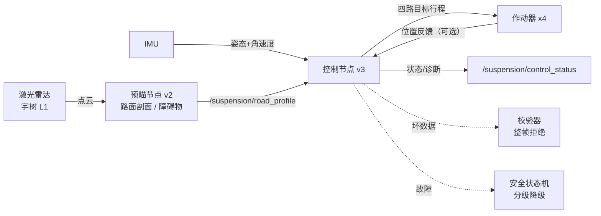

# 五分钟上手

> 这份文档面向**刚拿到代码的人**：用最短路径确认"它真的能跑"，然后告诉你改哪里。
> 完整设计思路、算法推导与参数说明在 **[README.md](README.md)**；版本记录在
> **[CHANGELOG.md](CHANGELOG.md)**。

## 0. 这是什么

一套跑在 ROS2 上的主动悬架预瞄控制系统：激光雷达扫车前 5 m 路面 → 生成左右轮迹的
高程剖面 → 提前给四根作动杆目标行程，同时用 IMU 做闭环修正，并用安全状态机兜底。
控制律有一条 PD 和一条增量式 LQI 可选，预瞄前馈有时间域 FIR。

**一句话定位**：感知（点云→路面剖面）+ 预瞄控制（提前量可算、可验证）+ 安全兜底
（坏数据一律拒绝，故障分级降级）三件事都做完了，且有 443 项离线检查护着。

## 1. 五分钟跑起来（不需要 ROS、不需要硬件）

控制内核**不依赖 ROS、不依赖 PCL**，一条 `g++` 命令就能编出来跑。
**下面每个代码块的起始目录都写在注释里**——这些命令用的路径是相对的，换目录就会
找不到文件：

```bash
cd src/suspension_control_v3          # 仓库根 → 本包
g++ -std=c++17 -O2 \
  -I include -I ../suspension_preview_v2/include \
  examples/control_selftest.cpp \
  src/input_validator.cpp src/controller.cpp src/attitude_filter.cpp \
  src/safety_state_machine.cpp src/control_loop.cpp src/temporal_fuser.cpp \
  src/param_check.cpp \
  -o /tmp/control_selftest

/tmp/control_selftest   # 编译器约 4 s；运行 0.01 s，输出 443 项检查结果
```

看到 `检查项 443，失败 0 -> 全部通过` 就说明代码是完整的、逻辑是通的。
这一条同时验证了：输入校验、安全状态机、两种控制律、预瞄前馈（单点与 FIR）、
多帧融合、姿态滤波链、位置反馈与堵转判定、急停与降级路径。

v2 的四个纯函数自检（同样不需要 ROS；**先回到仓库根目录**）：

```bash
cd "$(git rev-parse --show-toplevel)"   # 回到仓库根

# 路面趋势拟合（29 项）
g++ -std=c++17 -O2 -I src/suspension_preview_v2/include \
  src/suspension_preview_v2/examples/trend_selftest.cpp \
  src/suspension_preview_v2/src/road_trend.cpp -o /tmp/trend && /tmp/trend

# 障碍物检测（32 项）
g++ -std=c++17 -O2 -I src/suspension_preview_v2/include \
  src/suspension_preview_v2/examples/obstacle_selftest.cpp \
  src/suspension_preview_v2/src/obstacle_detect.cpp -o /tmp/obst && /tmp/obst

# 串口协议编解码（82 项）
g++ -std=c++17 -O2 -I src/suspension_preview_v2/include \
  src/suspension_preview_v2/examples/protocol_selftest.cpp \
  src/suspension_preview_v2/src/protocol.cpp -o /tmp/proto && /tmp/proto

# 启动参数校验（21 组致命判据，53 项）
g++ -std=c++17 -O2 -I src/suspension_preview_v2/include \
  src/suspension_preview_v2/examples/param_selftest.cpp \
  src/suspension_preview_v2/src/param_check.cpp \
  src/suspension_preview_v2/src/serial_port.cpp -o /tmp/param && /tmp/param

# 虚拟水平面（重力向量定姿，69 项）
g++ -std=c++17 -O2 -I src/suspension_preview_v2/include \
  src/suspension_preview_v2/examples/level_selftest.cpp \
  src/suspension_preview_v2/src/level_calibration.cpp -o /tmp/level && /tmp/level
```

# 这五条合计 265 项，加上 v3 的 443 项共 **708 项**

### 想跑内存与未定义行为检查

```bash
cd src/suspension_control_v3          # 同样要在本包目录下
g++ -std=c++17 -g -O1 -fsanitize=address,undefined -fno-omit-frame-pointer \
  -I include -I ../suspension_preview_v2/include \
  examples/control_selftest.cpp \
  src/input_validator.cpp src/controller.cpp src/attitude_filter.cpp \
  src/safety_state_machine.cpp src/control_loop.cpp src/temporal_fuser.cpp \
  src/param_check.cpp \
  -o /tmp/asan && /tmp/asan
```

退出码 0 表示没有越界访问、没有未定义行为。CI 里每次推送都会跑这三条。

## 2. 你拿到了什么

| 包 | 作用 | 依赖 ROS | 依赖 PCL |
|---|---|---|---|
| `unilidar_driver` | 宇树 L1 雷达驱动 + 报文解析 | 是 | 否 |
| `suspension_preview` | 初版预瞄节点（历史版本，留作对照） | 是 | 是 |
| `suspension_preview_v2` | 接口化预瞄：点云→路面剖面 + 障碍物 + 协议 | 是 | 是 |
| `suspension_control_v3` | 闭环控制 + 安全状态机 + 标定工具 | 节点依赖，**内核不依赖** | 否 |
| `car_balancer` | 早期姿态平衡包（历史版本） | 是 | 否 |

`src/suspension_control_v3/tools/lqr_gain_design.py` 是个独立的增益设计工具：
给定车体模态与作动器滞后，算出 PD / LQI / 预瞄 FIR 的增益，并自带收敛性与稳定
性自校验。纯 Python，无第三方依赖，直接 `python3` 跑。

## 3. 系统全貌



## 4. 怎么确认它是对的

三层，逐层变严：

1. **443 项离线检查** — 每条断言都针对一个具体行为（不是"跑了没崩"）。
   上面第 1 节已经跑过。
2. **ASan / UBSan** — 内存越界与未定义行为。独立 workflow（`sanitizer.yml`），
   徽章在 README 首屏。本项目靠它抓到过测试代码里的两处堆溢出（当时断言全绿）。
3. **CI** — 每次推送在干净容器里重新构建、跑全部自检、跑 sanitizer、量覆盖率。

覆盖率当前水位：`src/suspension_control_v3/src/` 六个源文件**行覆盖 100%**。
这个数字不是目的，用途是按图索骥找没测到的分支——本项目三轮覆盖提升都是这么推着
做的，每一轮都顺手抓出真问题（死代码、永假检查、假通过的断言）。

## 5. 想改哪里

**绝大多数改动只需要改参数，不用动代码。** 参数集中在
`src/suspension_control_v3/config/control_params.yaml`，每个都带注释说明"调它会
影响什么、边界情况是什么"：

| 你想做的事 | 改哪个 |
|---|---|
| 换控制律（PD / LQI） | `controller_kind` |
| 前馈强弱 | `feedforward_gain` |
| 预瞄取多远 | `lookahead_time_s`（随车速自适应） |
| 开/关预瞄 FIR | `use_preview_fir` + `preview_gains` |
| 姿态滤波强度 | `attitude_filter_alpha`、`use_attitude_filter_chain` |
| 堵转判定灵敏度 | `stall_error_mm` |
| 升降级快慢 | `degrade_after_unhealthy_s`、`stall_degrade_after_s` |

**要重新算增益**（换车体、换作动器之后）：

```bash
python3 src/suspension_control_v3/tools/lqr_gain_design.py
# 支持扫描作动器滞后 tau、查看各方案对比，输出可直接抄进 yaml
```

## 6. 要接真机，你还需要自己准备

代码侧都做完了，但这些只能上台架测：

- **车体模态** `wn` / `ζ`（可实测模态或据结构估算）→ 喂给 `lqr_gain_design.py`
- **作动器滞后 τ** → 同上；工具会给出 τ 与最优提前量的关系曲线
- **轴距、轮距、行程、死区** → 实测后写进 yaml
- **IMU 安装角与零位** → 上电静止时会自动标定，但要确认标定样本数够
- **作动器位置上回报文**（可选）→ 想用堵转检测就必须有；协议里已留好接口，
  发布到 `/suspension/actuator_position` 即可

## 7. 常见问题

**Q：没有硬件能看出控制效果吗？**
能。自检里有用合成路面验证的闭环用例（给定路面 → 断言每一步的输出版），包括
减速带、单侧无效、传感器丢包、作动器卡死等场景。但没有真机就不能验证"车真的不晃了"。

**Q：`SerialSuspensionDriver` 为什么不发位置查询？**
串口协议里还没有位置上报帧，那需要作动器 MCU 侧先定义。若你的 MCU 能回报位置，
接到 `/suspension/actuator_position` 话题即可，控制侧无需改动。

**Q：为什么开启 FIR 后没有车速就不工作？**
FIR 权重是按控制周期推的（时间域），落到空间剖面必须按 `车速 × 周期` 换算。
没有车速就无法换算，此时会自动退回单点取样并在状态里如实标注
（`feedforward_fir=false`），不是故障。

**Q：LQI 的三个增益默认是 0？**
是故意的。未整定时切成 LQI 会退化成"只前馈、不闭环"，节点会打 WARN 提示。
先用工具算好再填。

**Q：改动之后怎么知道有没有弄坏？**
跑第 1 节那条命令。443 项覆盖了主要路径与大部分错误路径。
