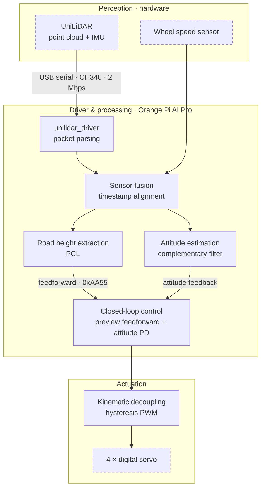
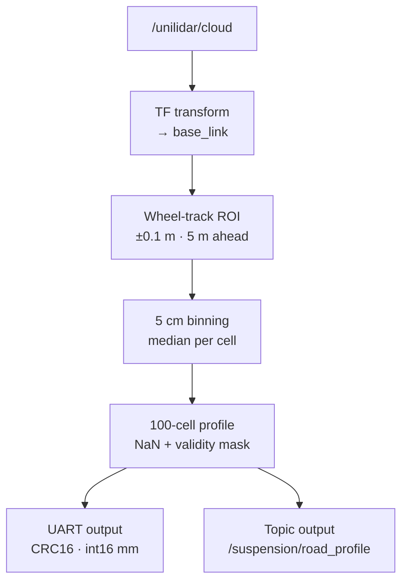
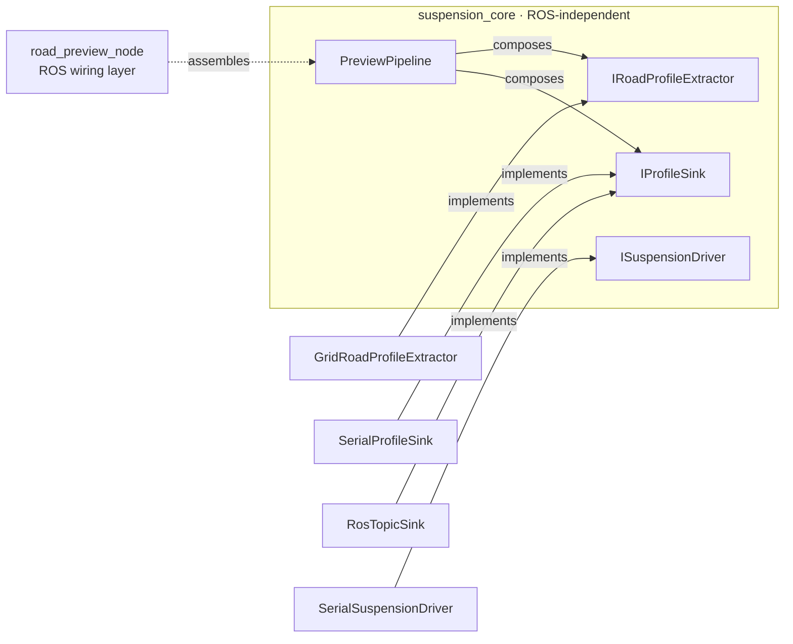
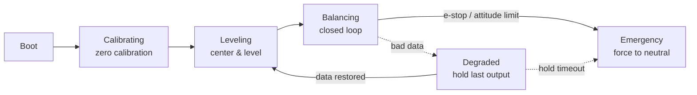

<div align="center">

# Active Suspension with LiDAR Road Preview

**National College Student Innovation and Entrepreneurship Training Program** · 基于激光雷达路面预瞄的主动悬架系统

Reads the road surface 0.5–5 m ahead with a LiDAR, speed-adaptive, fuses IMU attitude feedback, and drives four independent digital servos per wheel in real time to suppress body vibration and attitude fluctuation on unstructured terrain.

[](https://github.com/qi-neo/active-suspension-lidar-preview/actions/workflows/ros-ci.yml)
[](https://github.com/qi-neo/active-suspension-lidar-preview/actions/workflows/sanitizer.yml)
[](LICENSE)
[](https://docs.ros.org/en/humble/)
[](https://isocpp.org/)
[](#hardware)

English | [简体中文](README.md) | **[Quick start (5 min)](QUICKSTART.md)**

</div>

> **Highlights**
>
> - On-vehicle A/B testing (three runs on independently collected road sections): on the obstacle-crossing run, pitch fluctuation down ~29% and Z-axis acceleration disturbance down ~38%; on ordinary-road runs, roll/pitch fluctuation down ~12–21% (road inputs were not identical across runs — see "Experimental results")
> - Self-written packet parser and geometry conversion for the Unitree L1 (dual transport: serial and UDP, serial being the physical default) — no link against the official static library, usable as a drop-in replacement for the official node
> - The control core depends on neither ROS nor PCL and self-tests without the vehicle; the safety state machine covers both a degraded path and an emergency path

> CI runs `colcon build` on all five packages inside a ROS Humble container and
> executes six offline self-test groups (v3 control: 443 checks, driver packet parsing: 135
> checks, driver serial receive: 64 checks, driver serial stress: 14 checks, v2 pure
> functions: 196 checks, level calibration: 69
> checks — 921 in total). **Tags before v3.1.0 do not build** in a clean environment; see [CHANGELOG](CHANGELOG.md).

> **Just got the code?** Start with [QUICKSTART.md](QUICKSTART.md) — one `g++`
> command, a few seconds, no ROS and no hardware needed to confirm the code is
> complete and runnable (443 checks).

## Overview

An active suspension system that reads the road ahead with a LiDAR. Built on ROS2 with an Orange Pi AI Pro
as the onboard computer, it measures the road surface up to 5 m in front of the vehicle, fuses IMU attitude
feedback, and drives four independent digital servos to adjust each wheel in real time — suppressing body
vibration and attitude fluctuation on unstructured terrain.

Unlike purely reactive suspensions, this system knows the road 5 m before the wheels reach it, which removes
the "disturb first, compensate later" delay at its source.

### Hardware

| Component | Model / Spec | Role |
|-----------|--------------|------|
| LiDAR | **UniLiDAR L1** (Unitree 4D LiDAR) | Point cloud and IMU source |
| Onboard computer | Orange Pi AI Pro (8 TOPS) | Point cloud processing and real-time control |
| Actuator | **RDS3115 mg** digital servo ×4 | Independent four-wheel adjustment |
| Prototype vehicle | 400 × 300 × 200 mm | Stable operation at 3–8 km/h |
| Test bench | Conveyor-belt single-wheel rig | Emulates varying speed and road surface |

**UniLiDAR L1 (vendor specs):** FOV **360° × 90°** · range 30 m @90%/15 m @10% reflectivity (L1 RM;
20 m/10 m for L1 PM) · accuracy **±2.0 cm** · minimum range **0.05 m** · **21600 pts/s** effective
(43200 sampled) · scan **11 Hz** circumferential / **180 Hz** vertical · IMU 3-axis accel + 3-axis gyro ·
4D data (3D position + 1D intensity) · interface **TTL UART** · ≥100 Klux ambient light immunity ·
Class 1 eye safety · 6 W · 75×75×65 mm · 230 g.
✅ The vendor's **TTL UART** interface matches the hardware: the rig connects the L1 to the board over
**USB serial via a CH340 adapter** (`/dev/ttyUSB0`, 2 Mbps). Ethernet UDP (`192.168.1.62:6101` → host
`:6201`) is an **alternative** needing a serial-to-UDP adapter or a networked L1 variant.
Supply voltage is **not** published on the vendor page — confirm it on the cable before powering up.

**RDS3115 mg servo:** control **PWM** · pulse **500~2500 µs**, **neutral 1500 µs** · 180° across the range ·
3 µs dead band · 50~330 Hz · counter-clockwise · 5 V / 6.8 V · idle 4/5 mA · no-load 0.16 / 0.14 s per 60° ·
stall torque **15 / 17 kg·cm** · stall current **1.6 / 2.5 A** · metal gears · 3 wires
(red VCC, black/brown GND, yellow/white signal) on a 3-pin JR plug.
⚠️ These are **PWM** servos, not bus servos — and four stalled channels can pull ~10 A, so the servo rail
needs its own supply with headroom.

**Orange Pi AI Pro (8T):** SoC **Huawei Ascend 310B** — 4-core 64-bit ARM application processor
+ DaVinci AI core + integrated GPU · **8 TOPS INT8** · LPDDR4X 8/16 GB @3200 Mbps · storage
32 MB SPI flash, MicroSD, eMMC module (32–256 GB), M.2 2280 SATA/NVMe SSD · Gigabit Ethernet,
Wi-Fi 5 dual-band, BT 4.2/BLE · 2× HDMI 2.0 (4K@60), MIPI DSI, 2× MIPI CSI · USB: 2× USB 3.0 HOST,
1× USB-C 3.0 HOST, 1× **Micro USB debug console (via on-board CH343P)** · 40-pin header with 26 GPIO
supporting **GPIO / UART / I2C / SPI / I2S / PWM** · **USB-C PD 20 V, 65 W** · 107 × 68 mm, 82 g ·
Ubuntu / openEuler.

**Serial port — matters directly for this project.** The board uses **uart0 as the debug console**,
which is **`/dev/ttyS0`** — the very port this project sends actuator frames on. uart0 TX/RX are routed
to *two* places: 40-pin **pin 8 (TXD) / pin 10 (RXD)**, and the on-board **CH343P → Micro USB**.
The vendor requires **one or the other, never both**. GPIO on the 40-pin header is **3.3 V**;
pins **27/28 are I2C-only at 1.8 V**.

> ⚠️ Consequence: uart0 is both console and downlink. If you watch boot logs over Micro USB while
> running control, console characters interleave into the `0xAA55` stream and CRC fails repeatedly.
> Disable the console on uart0 before real runs, and never reuse pins 8/10 as GPIO.

**About the MCU:** the Ascend 310B integrates ARM *application* cores + a DaVinci AI core + GPU, but
there is **no independent real-time MCU** on the board (the CH343P is only a USB-UART bridge). Deterministic
200 Hz control therefore cannot be guaranteed on the Linux side — which is exactly why the
[`hardware/main-control-board/`](hardware/main-control-board) P0 board adds an external **STM32G4**.

## System architecture



Dashed nodes are hardware; everything else is implemented in this repository: packet parsing comes from
`unilidar_driver`, perception and processing from `suspension_preview_v2`,
closed-loop control and kinematic decoupling from `suspension_control_v3`. Driving the physical servos happens
behind `ISuspensionDriver`; the actual command set depends on the actuator protocol in use.

The L1 → driver edge shows the **physical link** (USB serial via CH340 at 2 Mbps); the driver's
`serial` transport (the `transport` default) is implemented exactly for it, with UDP as the
alternative — see [Wiring and physical interfaces](#wiring-and-physical-interfaces).

### Preview node data flow



The control node runs at 200 Hz (5 ms). The state machine lives in `suspension_control_v3`; besides the three
states described in the paper (`CALIBRATING → LEVELING → BALANCING`), it also handles degraded operation and
emergency stop when input data goes bad.

## Repository layout

```
active-suspension-lidar-preview/
├── src/
│   ├── unilidar_driver/              Unitree L1 driver: own packet parsing (serial/UDP dual transport), publishes cloud + IMU
│   ├── suspension_preview/           First-generation preview node (C++)
│   ├── suspension_preview_v2/        v2: core library + two nodes + offline demo
│   ├── suspension_control_v3/        v3: input validation + safety state machine + controller + self-test
│   └── car_balancer/                 Early attitude balancing package (Python)
└── docs/
    ├── paper/                        Project paper (text version, in Chinese)
    └── review/                       v1 code review, v2 upgrade notes
```

## Packages

### unilidar_driver — Unitree L1 LiDAR driver

Point cloud and IMU used to depend on the official `libunitree_lidar_sdk.a` prebuilt
static library, which hides the parsing logic and cannot be modified. This
package reimplements the Unitree L1 packet parsing and geometry conversion
from scratch, publishing standard `/unilidar/cloud` (PointCloud2) and
`/unilidar/imu` (Imu) topics as a drop-in replacement for the official node —
no other package needs to change. Transport is dual-path: **`serial` (default)**
uses CH340-to-USB `/dev/ttyUSB0` @ 2 Mbps (the L1's native TTL UART, the official
SDK's default wiring), `udp` uses the Ethernet alternative; both feed the same
`packet_parser`.

Frames are delimited by tail marker + CRC32 only, never by total packet length:
the byte counts in the official protocol header disagree with its own field
definitions (3D point packet documented 1036 B, computed from fields 1044 B),
and hardcoding a length would reject every packet from a newer firmware. On the
UDP alternative the bundled `udp_probe` tool checks the real packet length and
CRC validity on target hardware; on the serial path `serial_receiver_selftest`
(64 checks over a PTY virtual port on Linux; 63 on macOS, where `B2000000` is
missing) verifies reception offline, and `serial_stress_selftest` (14 checks)
feeds 2 Mbps through the same termios path with junk injected and periodic read
pauses. The parsing core
does not depend on ROS and can be built and self-tested on any machine.

It also fixes a QoS incompatibility present in the official node: that node
publishes as RELIABLE, while `suspension_control_v3` subscribes with
`SensorDataQoS` (BEST_EFFORT); the two are incompatible, which shows up as
"publishing but never receiving". This package publishes with `SensorDataQoS`
to match both in-repo consumers.

Details, on-target confirmation steps and verification scope:
[`src/unilidar_driver/README.md`](src/unilidar_driver/README.md) (in Chinese).

> **Also available as a standalone repository**:
> [qi-neo/unilidar-driver](https://github.com/qi-neo/unilidar-driver), since a LiDAR
> driver is a reusable asset unrelated to active suspension specifically. A copy is kept
> here so this repository builds standalone; **treat the standalone repo as the source of
> truth** and sync changes back. It also ships
> [`docs/driver-design.md`](https://github.com/qi-neo/unilidar-driver/blob/main/docs/driver-design.md),
> a methodology write-up on writing sensor drivers (in Chinese).

### suspension_preview — first-generation preview node (historical)

> Superseded by `suspension_preview_v2` and kept to reproduce the behaviour described
> in the paper. Use v2 for anything new.

A single file, `src/preview_node.cpp`, carries the whole chain from point cloud to UART:

1. Subscribe to `/unilidar/cloud`;
2. Transform into `base_link`;
3. Clip left and right wheel tracks (±10 cm) and 0–5 m ahead with PCL `PassThrough`;
4. Extract the road height profile into 100 cells on a 5 cm grid;
5. Stream it over UART (115200 bps) using a custom `0xAA55` protocol.

Parameters are macros at the top of the file, so any change requires recompilation.
Four known defects (subscriber QoS, UART not set to raw mode, no TF failure fallback,
invalid cells silently zeroed) are all fixed in v2; see the in-package `README.md` and
`docs/review/01-code-review-v1.md`.

### suspension_preview_v2 — interface-based rewrite

Three things changed relative to v1: point cloud parsing, output and actuator driving are now interfaces;
the ROS-independent part is a separate `suspension_core` library that can be reused and tested offline; and
the v1 defects around QoS compatibility, UART raw mode, TF failure handling and silently zeroing invalid
cells are all fixed.



| Interface | Responsibility | Implementations |
|-----------|----------------|-----------------|
| `IRoadProfileExtractor` | Parsing: point cloud → left/right wheel-track profiles | `GridRoadProfileExtractor` |
| `IProfileSink` | Output: delivering the profile | `RosTopicSink`, `SerialProfileSink` |
| `ISuspensionDriver` | Actuator driving: mode, target height, emergency stop | `SerialSuspensionDriver` |
| `PreviewPipeline` | Assembly: parse and dispatch | — |

See the in-package `README.md` and `docs/review/02-v2-upgrade-notes.md` (both in Chinese).

### suspension_control_v3 — closed-loop control and safety state machine

This is what turns the profile extracted by v2 into actual actuator commands. The control core depends on
neither ROS nor PCL, and can be compiled and self-tested without the vehicle.



| Interface | Responsibility |
|-----------|----------------|
| `IInputValidator` | Profile validation, rejecting 9 classes of bad data (NaN, out-of-range, low quality, illegal spacing or track width, frame mismatch, stale timestamp, excessive inter-frame jump, ...) |
| `ISafetyStateMachine` | Safety state machine and its three-branch output contract: use controller output / hold last value / force to neutral |
| `IController` | Preview feedforward (speed-adaptive + per-axle) + derivative-free PD + kinematic decoupling + amplitude and rate limiting |
| `IControlLoop` | Wires validation, state machine, controller and driver into one chain |

A few design points worth calling out:

- **Zero calibration**: measures the attitude reference while stationary, so "level" is still correct when the vehicle is parked on a slope
- **Degraded is time-bounded**: if input drops out for more than 5 s it escalates to an emergency stop and returns to neutral, rather than leaving the actuators parked at a stale position
- **Latched emergency stop**: requires clearing the stop before resetting, mirroring a physical e-stop button being released
- **Bounded step duration**: timer jitter cannot push the elapsed-time criteria past their thresholds in one step and cause a spurious stop
- **Hardware emergency stop**: entering the emergency state calls the driver's `emergency_stop()` in addition to sending a zero-position command

Four algorithmic details on the feedforward sampling distance (since v3.2.0):

- **Distance scales with speed**: sample distance = clamp(speed × response horizon,
  0.5 m, 5 m), where the horizon is 2.5× the time the actuator needs to traverse its
  full stroke (default 40 mm / 300 mm/s × 2.5 ≈ 0.33 s). A fixed distance under-samples
  at low speed and is simply too late at high speed — the paper's test speed is 0.5 m/s,
  where a fixed 1 m looks 2 s down the road. With no speed input (no `/odom`), the
  controller falls back to the fixed `lookahead_m`
- **Per-axle distances**: the rear axle samples one wheelbase closer than the front —
  the rear wheels meet the same road feature one "wheelbase / speed" later, so using one
  distance for both would feed pitch with road the rear wheels have not reached yet
- **Frame-age motion compensation**: the profile frame is anchored to the vehicle origin
  at capture time; by the current tick the vehicle has already travelled speed × frame
  age, and the sample position adds that distance back. At 10–20 Hz profiles the frame
  age is routinely 50–100 ms, so skipping this is a 100–200 mm systematic error at
  2 m/s. The actual sample position (= effective distance + compensation) is written to
  `ControlStatus.sample_position_m` every tick
- **Inter-cell interpolation and cross-lane fallback**: sampling interpolates between
  adjacent cells so the 5 cm quantization does not become a stair-stepped travel command;
  if one wheel track has no valid data the other track's height is borrowed, avoiding an
  asymmetric feedforward that reads as a phantom roll command (signalled by
  `ControlStatus.feedforward_fallback`, so it is observable)

The effective speed, sample distance and frame age are written into `ControlStatus`
every tick (`speed_mps` / `lookahead_m` / `profile_age_ms` / `sample_position_m`),
so "how far ahead did the feedforward actually look" is visible during integration.

443 offline self-test checks, requiring neither ROS nor hardware:

```bash
ros2 run suspension_control_v3 control_selftest
```

`tools/lqr_gain_design.py` in this package solves LQR / incremental-LQI gains from performance requirements,
replacing hand-tuned `kp`/`kd` with gains derived from explicit targets.

### car_balancer — early attitude balancing package

`test_imu_node.py` subscribes to `/unilidar/imu` and prints quaternion, angular velocity and linear
acceleration once every 50 messages, for integration debugging.

```bash
ros2 run car_balancer test_imu_node
```

The two `setup.py` entry points were originally missing a comma and got implicitly concatenated, and
`test_imu_node.py` sat outside the module directory, so neither command worked. Both are fixed now. A third
entry, `balancer_node`, pointed at a module never shipped with the package and has been removed. Details in
`docs/review/01-code-review-v1.md`.

## Quick start

```bash
# 1. Workspace: place the repository under src/
mkdir -p ~/ws/src && cd ~/ws/src
git clone https://github.com/qi-neo/active-suspension-lidar-preview
# To compare against the official node, also clone the official SDK
# (the in-repo driver does not depend on it)
# git clone https://github.com/unitreerobotics/unilidar_sdk
# The driver also has a standalone repository (with a write-up of the driver design);
# the contents are identical, use whichever suits you:
# git clone https://github.com/qi-neo/unilidar-driver

# 2. Build
cd ~/ws
colcon build --packages-select unilidar_driver suspension_preview suspension_preview_v2 suspension_control_v3
source install/setup.bash

# 3. With real hardware: probe first to confirm packets arrive and check the real packet length
ros2 run unilidar_driver udp_probe --port 6201 --seconds 5 --hex

# 4. Run the driver as a drop-in replacement for the official node
ros2 launch unilidar_driver unilidar_driver.launch.py

# 5. Run v2 (topic output only, no hardware attached)
ros2 launch suspension_preview_v2 preview_v2.launch.py enable_serial:=false
ros2 topic echo /suspension/road_profile --once

# 6. Run v3 closed-loop control (compute only, nothing sent to hardware)
ros2 launch suspension_control_v3 control_v3.launch.py enable_driver:=false
```

All three C++ packages (the historical `suspension_preview` aside) ship offline checks that confirm the pipeline without any hardware:

```bash
ros2 run unilidar_driver decoder_selftest           # packet parsing and decoding, 135 checks
ros2 run unilidar_driver serial_receiver_selftest   # serial receive (PTY virtual port), 64 checks (63 on macOS)
ros2 run unilidar_driver serial_stress_selftest     # serial stress (2 Mbps feed, 60 s default), 14 checks
ros2 run suspension_preview_v2 offline_demo        # point cloud parsing chain
ros2 run suspension_preview_v2 level_selftest      # virtual level calibration (Gram-Schmidt), 69 checks
ros2 run suspension_control_v3 control_selftest    # control and safety logic, 443 checks
```

Dependencies: ROS2 (Humble or Jazzy recommended), `rclcpp`, `sensor_msgs`, `pcl_ros`, `pcl_conversions`,
`tf2_ros`. The `unilidar_driver` package additionally needs `tf2` and `tf2_ros`, and does **not**
depend on the Unitree Lidar SDK.

### Visualisation in Rviz2

Confirm the raw data is sane before tuning preview or control:

```bash
ros2 launch unilidar_driver unilidar_driver.launch.py
rviz2   # Fixed Frame = unilidar_lidar; add PointCloud2 → /unilidar/cloud, Imu → /unilidar/imu

# Or, for comparison, the official Unitree SDK (cloned separately; this repo does not depend on it)
git clone https://github.com/unitreerobotics/unilidar_sdk.git
cd unilidar_sdk/unitree_lidar_ros2 && colcon build
source install/setup.bash && ros2 launch unitree_lidar_ros2 launch.py
```

Check: does the cloud form a full ring (360°×90°)? Any returns inside 0.05 m? Is `w` ≈ ±1 with the
LiDAR level and static? If the official node displays but this driver does not, suspect **QoS or frame
framing**, not the hardware — compare real packet lengths with `udp_probe` first.

### Driver defaults vs L1 vendor specs

The defaults are chosen to "just run"; several differ from what the L1 can actually do. Review before
running on hardware:

| Parameter | Default | L1 vendor spec | Recommendation |
|-----------|---------|----------------|----------------|
| `range_max` | `100.0` m | 20–30 m (model and reflectivity dependent) | **Set ≤30 m.** The default far exceeds real range and disables useful range gating |
| `range_min` | `0.0` m | 0.05 m minimum range | Set 0.05–0.1 m to drop unreliable near returns |
| `cloud_scan_num` | `18` | 180 Hz vertical, 11 Hz circumferential | 18 → ~10 Hz clouds, close to 11 Hz; try 16 for ~11 Hz |
| `quaternion_order` | `xyzw` | not fixed by vendor | With the LiDAR level and static, `w` should be ≈ ±1; otherwise use `wxyz` |
| `local_port` | `6201` | LiDAR 6101 / host 6201 | Match the LiDAR's target address |

## Wiring and physical interfaces

The prototype has only **two data links** (one USB serial via CH340, one UART) plus **two power rails**.

| Link | Physical | Electrical | Protocol | Key parameters | Config |
|------|----------|-----------|----------|----------------|--------|
| Board ↔ UniLiDAR L1 | **USB (via CH340 adapter)** | **TTL UART → USB** | private / MavLink frames | `/dev/ttyUSB0`, **2,000,000 bps**; needs `dialout` | see Ethernet UDP alternative below |
| L1 power | DC | 6 W (**confirm voltage on the cable label**; not published on the vendor page) | — | isolate from actuator power, add reverse-polarity + TVS protection | `hardware/sensors-interface/` |
| Board ↔ actuator controller | UART (40-pin **pin 8 TXD / pin 10 RXD** = `/dev/ttyS0`) | **3.3 V TTL** | custom `0xAA55` frame | 115200 8N1 (up to 921600); raw mode, no hardware flow control, write-all + `tcdrain` | `serial_port` / `baud_rate` |
| Actuator controller ↔ 4 × **RDS3115 mg** | 3-pin JR plug (red VCC / black GND / yellow PWM) | PWM pulse width | **500~2500 µs, neutral 1500 µs, 50~330 Hz** | order `0=front-left 1=front-right 2=rear-left 3=rear-right` | wrapped under `ISuspensionDriver` |
| Servo power | DC | 5 V / 6.8 V | — | stall **2.5 A per channel**, budget ≥10 A for four, **isolate from logic power** | — |

**UniLiDAR L1 — USB serial (CH340 adapter), not Ethernet.** The L1's native interface is **TTL UART**
(the vendor spec sheet lists "TTL UART" too), and USB serial is the **default** mode of the official
Unitree SDK. Wiring: `L1 (TTL UART) → CH340 adapter → USB → board → /dev/ttyUSB0`.

- **Device**: usually `/dev/ttyUSB0` on Linux (`ls /dev/ttyUSB*`); pin it with a udev rule when several
  USB-serial devices are present.
- **Baud rate: `2,000,000`** (official SDK default) — needed for IMU at 100–1000 Hz plus aggregated scans.
- **Permission**: `sudo usermod -aG dialout $USER`, then re-login (do not `chmod 777`).
- **Power**: 6 W; the vendor page does not publish the voltage — confirm it on the cable before powering up.

> ⚠️ **CH340 at 2 Mbps needs verifying.** CH340 is specced up to 2 Mbps, but on Linux it uses the
> `ch341` driver, and support for such a non-standard baud rate is not reliable across all versions.
> If the device enumerates but no data arrives (or frames are mostly bad), suspect the baud rate / adapter
> chip (compare with a CP2102 or FT232) before blaming the LiDAR.

**Alternative: Ethernet UDP.** With a serial-to-UDP adapter board or a networked L1 variant, data
arrives as UDP: LiDAR `192.168.1.62:6101` → host `192.168.1.2:6201`. Set the driver's `transport`
parameter to `udp` and configure it via `local_ip` / `local_port` / `source_ip`.

> ✅ **Both transports are implemented.** `unilidar_driver` switches with the `transport` parameter:
> **`serial` (default)** goes through `serial_receiver.hpp` on `/dev/ttyUSB0` @ 2 Mbps — the
> physical link above; `udp` goes through `udp_receiver.hpp`. The serial receiver has 64 offline
> checks (`serial_receiver_selftest`, a PTY virtual serial port covering whole-frame delivery,
> split writes, junk/fake-header resynchronisation, the no-data contract, multiple frames per
> write, IMU frames and open-failure paths; 63 on macOS — the 2 Mbps assertion needs the Linux-only
> `B2000000` termios constant). On top of that, `serial_stress_selftest` adds 14 checks: a PTY
> master feeding 2 Mbps of synthetic frames with junk and fake headers injected and periodic read
> pauses, asserting frames fed == frames decoded, zero CRC/tail/sequence false alarms and bounded
> buffers and memory — 60 s locally decoded all 126,636 fed frames. A real `packet_parser` bug
> (losing a whole frame after a bad one) was first caught by it.
> `packet_parser` is designed for a boundary-less byte
> stream (serial may start mid-frame), so both paths feed the same parser with zero protocol-layer
> changes.

Frames: `unilidar_lidar` / `unilidar_imu` → `base_link`.
⚠️ Quaternion order is not fixed by the vendor; default `xyzw` — with the LiDAR level and static,
`w` should be ≈ ±1 and the rest ≈ 0.

**Actuator downlink — UART / `0xAA55`.** `/dev/ttyS0` at 115200 8N1 (up to 921600), on 40-pin
**pin 8 (TXD) / pin 10 (RXD)** at **3.3 V TTL**. If the controller side is 5 V logic, add level
shifting — 3.3 V out is usually accepted by a 5 V input, but 5 V fed back **will damage the board**.
⚠️ uart0 is *also* the on-board debug console (via CH343P → Micro USB). The vendor requires choosing
**one** of the two: disable the console on uart0 when running control, or console output (login prompt,
kernel messages) will corrupt the `0xAA55` stream and fail CRC. Do not reuse pins 8/10 as GPIO.
v2 frames are `int16` mm + CRC16; v1 used `float32` + an 8-bit checksum — **not compatible**.
Serial permission: `sudo usermod -aG dialout $USER`, then re-login (do not `chmod 777`).
At 115200 bps the frame size collides head-on with a 10–20 Hz LiDAR rate, which is why v2 switched to
`int16` and offers higher baud rates.

**Servo side — confirmed: PWM servos (RDS3115 mg).** Three wires per servo: `red=VCC`,
`black(brown)=GND`, `yellow(white)=PWM`, on a 3-pin JR-style plug. The controller drives **4 independent
PWM channels**: frequency 50~330 Hz (50 Hz = 20 ms period is typical), pulse width **500~2500 µs**,
**neutral 1500 µs**, 180° across the range, 3 µs dead band.

**The software↔mechanics conversion must be calibrated on a rig.** The `0xAA55` frame carries a target
**height in mm**, but the servo only understands **pulse width**. The chain is
`height mm → rocker angle ° → pulse width µs`, and the transmission ratio comes from the linkage —
it cannot be derived from code. Measure several (height ↔ pulse width) pairs with the linkage in place,
fit a linear map, and write it into the controller; re-calibrate whenever the linkage changes.

**Wiring checklist:** L1 voltage confirmed from the cable label · CH340 adapter on a board USB port and
`ls /dev/ttyUSB*` shows the device · baud rate set to **2,000,000** and user in `dialout` (pin the name
with a udev rule) · data arrives steadily (on the UDP alternative, `udp_probe` sees packets of the
expected length) · **GND shared** between board and actuator controller (a floating ground is the usual
cause of "works intermittently")
· servo PWM frequency and pulse range written to the controller (500~2500 µs), **verified unloaded
before fitting the linkage** · rig-calibrate the `height mm ↔ pulse width` map and record the ratio
· servo supply (5/6.8 V, ≥10 A headroom) isolated from logic/compute power · verify wheel order and
direction one channel at a time before driving · emergency stop independent of software.

## Interface reference

All interface contracts in one place. Most "only shows up on real hardware" bugs here trace back to a
mismatch in an *implicit* agreement between the two ends: QoS, `frame_id`, units, or CRC coverage.

**Layers**

| Layer | Interface | Transport | Code |
|-------|-----------|-----------|------|
| Physical | LiDAR uplink | Serial (`transport=serial`, default: CH340-to-USB, `/dev/ttyUSB0` @ 2,000,000 bps) or UDP (`transport=udp`, `local_port`, default **6201**) | `unilidar_driver/serial_receiver.hpp` / `udp_receiver.hpp` |
| Physical | Actuator downlink | UART (default `/dev/ttyS0` @ 115200, up to 921600) | `suspension_preview_v2/serial_port.hpp` |
| Comms | Inter-node data | ROS2 topics + custom messages + QoS | see below |
| Abstract | Actuator driver | `ISuspensionDriver` | `suspension_preview_v2/suspension_driver.hpp` |
| Abstract | Command channel | `ICommandSink` | `suspension_control_v3/command_sink.hpp` |
| Abstract | Profile output | `IProfileSink` | `suspension_preview_v2/profile_sink.hpp` |

**Topics (defaults)**

| Topic | Type | Direction | QoS | Parameter |
|-------|------|-----------|-----|-----------|
| `/unilidar/cloud` | `sensor_msgs/PointCloud2` | driver → preview | SensorDataQoS | `cloud_topic` |
| `/unilidar/imu` | `sensor_msgs/Imu` | driver → preview / control / calibration | SensorDataQoS | `imu_topic` |
| `/suspension/road_profile` | `msg/RoadProfile` | preview → control | SensorDataQoS | `publish_topic` / `profile_topic` |
| `/suspension/road_obstacles` | `msg/RoadObstacles` | preview → control | depth 10 | `obstacles_topic` |
| `/suspension/control_status` | `msg/ControlStatus` | control → monitoring | depth 10 | `status_topic` |
| `/odom` | `nav_msgs/Odometry` | odometry → control | SensorDataQoS | `speed_topic` |
| `/suspension/actuator_position` | `std_msgs/Int32MultiArray` | feedback → control | SensorDataQoS | `actuator_position_topic` |
| `/suspension/emergency_stop` | `std_msgs/Bool` | external → control + driver | depth 10 | fixed |
| `/suspension/reset` | `std_msgs/Bool` | external → control | depth 10 | fixed |
| `/suspension/mode` | `std_msgs/Int32` | external → driver node | depth 10 | fixed |
| `/suspension/target_height` | `std_msgs/Int32MultiArray` | external → driver node | depth 10 | fixed |

> QoS is part of the contract, not an option. The LiDAR publishes `BEST_EFFORT`, so every
> subscriber downstream must use `rclcpp::SensorDataQoS()`. With the default `RELIABLE` the symptom
> is "the topic has data but the callback never fires" — the most common integration failure here.

**Serial frame (0xAA55, little-endian)**

```
offset:  0      1      2     3     4-5        6 .. 6+2N-1      last 2 bytes
        ┌──────┬──────┬─────┬─────┬──────────┬───────────────┬────────────┐
        │ 0xAA │ 0x55 │ id  │ seq │ count    │ N x int16     │ CRC16      │
        └──────┴──────┴─────┴─────┴──────────┴───────────────┴────────────┘
        └────────── CRC16 covers 6 + 2N bytes ──────────┘
```

CRC16-CCITT-FALSE (poly `0x1021`, init `0xFFFF`) covers **header through payload end, excluding the
CRC field itself**. Payload unit is **mm** (int16); invalid samples are `0x7FFF`; payload is capped at
`kMaxPayloadPoints = 2048`. Command ids: `0x01` left track, `0x02` right track, `0x10` set mode,
`0x11` set target height, `0x12` emergency stop.

**Contracts**

| Item | Convention |
|------|------------|
| Length unit | ROS messages use **metres** (float); serial frames use **millimetres** (int16) |
| Wheel order | `0=front-left 1=front-right 2=rear-left 3=rear-right` |
| Height reference | relative to the calibration zero; **positive = raise** |
| Invalid sample | `NaN` + mask `kInvalid=0` internally; `0x7FFF` on the wire |
| Attitude sign | `roll>0` = right side down; `pitch>0` = front down; positive output raises that corner |
| Frames | `unilidar_lidar` / `unilidar_imu` → `base_link`; control validates `header.frame_id` against `expected_frame` |
| Quaternion | `sensor_msgs/Imu` convention (x fwd / y left / z up); `quaternion_order` defaults to `xyzw`; **must be unit** |

## Key parameters

| Parameter | v2 | Note (vs v1) |
|-----------|----|--------------|
| Preview distance | `preview_dist` | 5.0 m; v1 used the `PREVIEW_DIST` macro |
| Longitudinal resolution | `resolution` | cell count derived from it; v1 hard-coded 5 cm |
| Track width | `lane_half_width` | 0.1 m; v1 hard-coded ±10 cm |
| Ground height window | `ground_z_min/max` | verify against your frame convention; v1 hard-coded ±0.5 m |
| Per-cell statistic | `use_median` | median by default; v1 used mean |
| Serial port | `serial_port` / `baud_rate` | configurable up to 921600; v1 hard-coded `/dev/ttyS0` @115200 |
| Configuration style | YAML + launch | applied at runtime; v1 used macros that required recompilation |

## Experimental results

On-vehicle A/B testing, active versus passive (data taken from the raw trial-record spreadsheets; each run was collected independently on a different road section):

| Run | Metric | Passive | Active | Improvement |
|-----|--------|---------|--------|-------------|
| 01 ordinary road | Body roll angle | −3.24° ~ +4.86° | −3.38° ~ +2.99° | +21% |
| 01 ordinary road | Body pitch angle | −1.02° ~ +1.16° | −0.78° ~ +1.14° | +12% |
| 01 ordinary road | Z-axis acceleration | 0.36g | 0.32g | +10% |
| 02 | Body roll angle | −2.11° ~ +3.18° | −2.30° ~ +2.97° | +0% |
| 02 | Body pitch angle | −2.65° ~ +1.18° | −2.43° ~ +1.75° | −9% |
| 02 | Z-axis acceleration | 0.30g | 0.36g | −20% |
| 03 obstacle impact | Body roll angle | −0.60° ~ +0.62° | −0.48° ~ +1.13° | −32% |
| 03 obstacle impact | Body pitch angle | −4.10° ~ +15.5° | −3.19° ~ +10.7° | +29% |
| 03 obstacle impact | Z-axis acceleration | 0.93g | 0.57g | +38% |

Fluctuation = peak-to-peak of the attitude angles / vertical acceleration (relative to each run's own mean) over the dynamic driving segment (passive: `Mode=0` segment; active: whole run). Improvement = (passive − active) / passive. The three runs were collected independently on different road sections; for run 02 the active side is slightly higher in pitch and vertical, and for run 03 the active side is slightly larger in roll — likely because the road inputs differed between runs. Listed as-is.

Core methods of the attitude controller:

- **Gravity-adaptive calibration**: Gram-Schmidt orthogonalization builds a virtual horizontal plane; stationary detection uses σ_a < 0.05g and σ_g < 0.015°/s;
- **Multi-stage anti-noise filtering**: first-order low-pass (α_g=0.08, α_a=0.05) → moving average (window 40) → complementary filter (α=0.992) → soft dead zone (0.25°);
- **Derivative-free PD**: gyro angular velocity replaces the differentiated error to avoid amplifying noise; tuned to Kp=1.85, Kd=0.85;
- **Kinematic decoupling and hysteresis PWM**: removes high-frequency chatter at the end effector.

The original paper is a PDF; a text version is under `docs/paper/` (in Chinese).

## Downlink bandwidth

Each frame carries two wheel tracks of 100 points each:

| Version | Single-track frame | Per frame | @115200 bps | @460800 bps |
|---------|-------------------|-----------|-------------|-------------|
| v1 | 405 B (float32 + sum) | 810 B | ~14 frame/s | not supported |
| v2 | 208 B (int16 mm + CRC16) | 416 B | ~28 frame/s | ~111 frame/s |

At 115200 bps the v1 ceiling collides with the LiDAR's 10–20 Hz output — the reason v2 moved to int16 and
exposed the higher baud rate.

## FAQ

**No point cloud arrives; the node starts but prints nothing**
QoS mismatch between publisher and subscriber. LiDARs usually publish with `BEST_EFFORT`, so the subscriber
must use `SensorDataQoS`. v1 used the default `RELIABLE` profile, a common cause of this symptom.

**Failed to open the serial port**
A permissions problem. Add your user to the `dialout` group and log in again:
`sudo usermod -aG dialout $USER`. Do not use `chmod 777`.

**Downstream parses the height data incorrectly**
Check baud rate and frame format first. v1 and v2 frames are incompatible (v1: float32 plus an 8-bit sum;
v2: int16 millimetres plus CRC16), so the downstream parser has to be updated to match.

**NaN or 0x7FFF appears in the profile**
That cell was judged invalid: too few points, intra-cell height spread above `max_cell_spread` (suspected
obstacle), or outside the `ground_z_min/max` window. Enable `interpolate_gaps` for linear interpolation if needed.

**TF errors, or the node never publishes**
v2 drops the frame when TF is unavailable instead of publishing anyway. Check that the transform between
`base_link` and the LiDAR frame is being published, and relax `tf_timeout_ms` if necessary.

## Quality gates

CI runs in two workflows and gates every PR:

| Check | Workflow | What actually runs | Fails when |
|---|---|---|---|
| Build | `ros-ci.yml` → `build` | `colcon build` for all packages + `colcon test` + five offline self-tests in a ROS Humble container | compile error / failed CTest assertion |
| ASan + UBSan | `sanitizer.yml` → `sanitize` | pure-logic self-tests compiled with `-fsanitize=address,undefined` | out-of-bounds, use-after-free, integer overflow, undefined behaviour |
| Coverage | `ros-ci.yml` → `coverage` | `gcovr` over the control and preview core sources | line coverage < 80% or branch coverage < 70% |
| Dependency & param consistency | `ros-ci.yml` → pre-build steps | `tools/check_deps.py`, `tools/check_ros_params.py` | CMakeLists / package.xml drift, node params vs YAML mismatch |

Scope: the sanitizer only covers the ROS/PCL-free logic layer; real nodes and the PCL point-cloud path are
built but not instrumented. Coverage excludes `serial_port.cpp` (termios-only I/O) because an offline
self-test can only reach `is_baud_supported` there and instrumenting it would drag the branch gate down.

These checks are not decorative: ASan once caught a heap out-of-bounds write (a 999 "no bump" sentinel used
to index a 100-cell array) while all 234 assertions passed — assertions verify values, not memory.

Failures are posted as a PR comment automatically, so reading them does not require access to Actions logs.

## License

[MIT](LICENSE). Please keep attribution when redistributing or building upon this work. The paper and the
hardware design remain the property of the project team.
