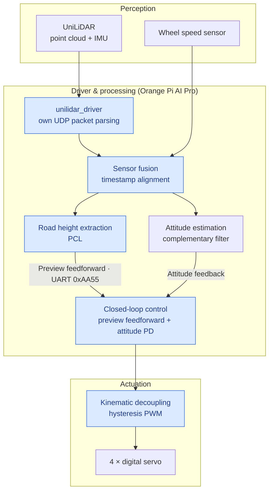
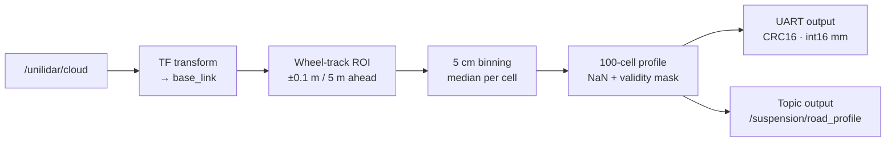
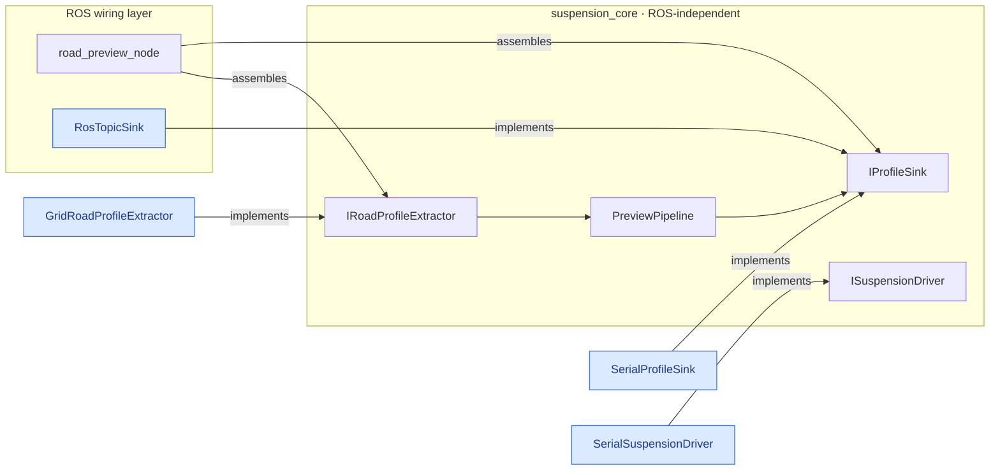
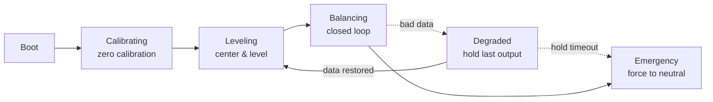

# Active Suspension with LiDAR Road Preview

National College Student Innovation and Entrepreneurship Training Program

ROS2 · C++ · PCL · Embedded · Multi-sensor fusion

[简体中文](README.md) | English

[](https://github.com/qi-neo/active-suspension-lidar-preview/actions/workflows/ros-ci.yml)

> CI runs `colcon build` on all five packages inside a ROS Humble container and
> executes three offline self-tests (v3 control: 142 checks, driver parsing: 63
> checks, v2 point-cloud pipeline). Starting from **v3.1.0** the packages build
> cleanly — **earlier tags do not build**. See [CHANGELOG](CHANGELOG.md).

## Overview

An active suspension system that reads the road ahead with a LiDAR. Built on ROS2 with an Orange Pi AI Pro
as the onboard computer, it measures the road surface up to 5 m in front of the vehicle, fuses IMU attitude
feedback, and drives four independent digital servos to adjust each wheel in real time — suppressing body
vibration and attitude fluctuation on unstructured terrain.

Unlike purely reactive suspensions, this system knows the road 5 m before the wheels reach it, which removes
the "disturb first, compensate later" delay at its source.

### Hardware

| Component | Model / Spec | Role |
|-----------|--------------|------|
| LiDAR | UniLiDAR (Unitree) | Point cloud and IMU source |
| Onboard computer | Orange Pi AI Pro (8 TOPS) | Point cloud processing and real-time control |
| Actuator | Digital servo ×4 | Independent four-wheel adjustment |
| Prototype vehicle | 400 × 300 × 200 mm | Stable operation at 3–8 km/h |
| Test bench | Conveyor-belt single-wheel rig | Emulates varying speed and road surface |

## System architecture



Blue nodes are implemented in this repository: packet parsing comes from `unilidar_driver`, perception and
processing from `suspension_preview_v2`,
closed-loop control and kinematic decoupling from `suspension_control_v3`. Driving the physical servos happens
behind `ISuspensionDriver`; the actual command set depends on the actuator protocol in use.

### Preview node data flow



The control node runs at 200 Hz (5 ms). The state machine lives in `suspension_control_v3`; besides the three
states described in the paper (`CALIBRATING → LEVELING → BALANCING`), it also handles degraded operation and
emergency stop when input data goes bad.

## Repository layout

```
active-suspension-lidar-preview/
├── src/
│   ├── unilidar_driver/              Unitree L1 driver: own UDP protocol parsing, publishes cloud + IMU
│   ├── suspension_preview/           First-generation preview node (C++)
│   ├── suspension_preview_v2/        v2: core library + two nodes + offline demo
│   ├── suspension_control_v3/        v3: input validation + safety state machine + controller + self-test
│   └── car_balancer/                 Early attitude balancing package (Python)
└── docs/
    ├── paper/                        Project paper (text version, in Chinese)
    └── review/                       v1 code review, v2 upgrade notes
```

## Packages

### unilidar_driver — Unitree L1 LiDAR driver

Point cloud and IMU used to depend on the official `unitree_lidar_sdk` prebuilt
static library, which hides the parsing logic and cannot be modified. This
package reimplements the Unitree L1 UDP packet parsing and geometry conversion
from scratch, publishing standard `/unilidar/cloud` (PointCloud2) and
`/unilidar/imu` (Imu) topics as a drop-in replacement for the official node —
no other package needs to change.

Frames are delimited by tail marker + CRC32 only, never by total packet length:
the byte counts in the official protocol header disagree with its own field
definitions (3D point packet documented 1036 B, computed from fields 1044 B),
and hardcoding a length would reject every packet from a newer firmware. The
bundled `udp_probe` tool checks the real packet length and CRC validity on
target hardware. The parsing core does not depend on ROS and can be built and
self-tested on any machine.

It also fixes a QoS incompatibility present in the official node: that node
publishes as RELIABLE, while `suspension_control_v3` subscribes with
`SensorDataQoS` (BEST_EFFORT); the two are incompatible, which shows up as
"publishing but never receiving". This package publishes with `SensorDataQoS`
to match both in-repo consumers.

Details, on-target confirmation steps and verification scope:
[`src/unilidar_driver/README.md`](src/unilidar_driver/README.md) (in Chinese).

> **Also available as a standalone repository**:
> [qi-neo/unilidar-driver](https://github.com/qi-neo/unilidar-driver), since a LiDAR
> driver is a reusable asset unrelated to active suspension specifically. A copy is kept
> here so this repository builds standalone; **treat the standalone repo as the source of
> truth** and sync changes back. It also ships
> [`docs/driver-design.md`](https://github.com/qi-neo/unilidar-driver/blob/main/docs/driver-design.md),
> a methodology write-up on writing sensor drivers (in Chinese).

### suspension_preview — first-generation preview node (historical)

> Superseded by `suspension_preview_v2` and kept to reproduce the behaviour described
> in the paper. Use v2 for anything new.

A single file, `src/preview_node.cpp`, carries the whole chain from point cloud to UART:

1. Subscribe to `/unilidar/cloud`;
2. Transform into `base_link`;
3. Clip left and right wheel tracks (±10 cm) and 0–5 m ahead with PCL `PassThrough`;
4. Extract the road height profile into 100 cells on a 5 cm grid;
5. Stream it over UART (115200 bps) using a custom `0xAA55` protocol.

Parameters are macros at the top of the file, so any change requires recompilation.
Four known defects (subscriber QoS, UART not set to raw mode, no TF failure fallback,
invalid cells silently zeroed) are all fixed in v2; see the in-package `README.md` and
`docs/review/01-code-review-v1.md`.

### suspension_preview_v2 — interface-based rewrite

Three things changed relative to v1: point cloud parsing, output and actuator driving are now interfaces;
the ROS-independent part is a separate `suspension_core` library that can be reused and tested offline; and
the v1 defects around QoS compatibility, UART raw mode, TF failure handling and silently zeroing invalid
cells are all fixed.



| Interface | Responsibility | Implementations |
|-----------|----------------|-----------------|
| `IRoadProfileExtractor` | Parsing: point cloud → left/right wheel-track profiles | `GridRoadProfileExtractor` |
| `IProfileSink` | Output: delivering the profile | `RosTopicSink`, `SerialProfileSink` |
| `ISuspensionDriver` | Actuator driving: mode, target height, emergency stop | `SerialSuspensionDriver` |
| `PreviewPipeline` | Assembly: parse and dispatch | — |

See the in-package `README.md` and `docs/review/02-v2-upgrade-notes.md` (both in Chinese).

### suspension_control_v3 — closed-loop control and safety state machine

This is what turns the profile extracted by v2 into actual actuator commands. The control core depends on
neither ROS nor PCL, and can be compiled and self-tested without the vehicle.



| Interface | Responsibility |
|-----------|----------------|
| `IInputValidator` | Profile validation, rejecting 9 classes of bad data (NaN, out-of-range, low quality, illegal spacing or track width, frame mismatch, stale timestamp, excessive inter-frame jump, ...) |
| `ISafetyStateMachine` | Safety state machine and its three-branch output contract: use controller output / hold last value / force to neutral |
| `IController` | Preview feedforward (speed-adaptive + per-axle) + derivative-free PD + kinematic decoupling + amplitude and rate limiting |
| `IControlLoop` | Wires validation, state machine, controller and driver into one chain |

A few design points worth calling out:

- **Zero calibration**: measures the attitude reference while stationary, so "level" is still correct when the vehicle is parked on a slope
- **Degraded is time-bounded**: if input drops out for more than 5 s it escalates to an emergency stop and returns to neutral, rather than leaving the actuators parked at a stale position
- **Latched emergency stop**: requires clearing the stop before resetting, mirroring a physical e-stop button being released
- **Bounded step duration**: timer jitter cannot push the elapsed-time criteria past their thresholds in one step and cause a spurious stop
- **Hardware emergency stop**: entering the emergency state calls the driver's `emergency_stop()` in addition to sending a zero-position command

Four algorithmic details on the feedforward sampling distance (since v3.2.0):

- **Distance scales with speed**: sample distance = clamp(speed × response horizon,
  0.5 m, 5 m), where the horizon is 2.5× the time the actuator needs to traverse its
  full stroke (default 40 mm / 300 mm/s × 2.5 ≈ 0.33 s). A fixed distance under-samples
  at low speed and is simply too late at high speed — the paper's test speed is 0.5 m/s,
  where a fixed 1 m looks 2 s down the road. With no speed input (no `/odom`), the
  controller falls back to the fixed `lookahead_m`
- **Per-axle distances**: the rear axle samples one wheelbase closer than the front —
  the rear wheels meet the same road feature one "wheelbase / speed" later, so using one
  distance for both would feed pitch with road the rear wheels have not reached yet
- **Frame-age motion compensation**: the profile frame is anchored to the vehicle origin
  at capture time; by the current tick the vehicle has already travelled speed × frame
  age, and the sample position adds that distance back. At 10–20 Hz profiles the frame
  age is routinely 50–100 ms, so skipping this is a 100–200 mm systematic error at
  2 m/s. The actual sample position (= effective distance + compensation) is written to
  `ControlStatus.sample_position_m` every tick
- **Inter-cell interpolation and cross-lane fallback**: sampling interpolates between
  adjacent cells so the 5 cm quantization does not become a stair-stepped travel command;
  if one wheel track has no valid data the other track's height is borrowed, avoiding an
  asymmetric feedforward that reads as a phantom roll command (signalled by
  `ControlStatus.feedforward_fallback`, so it is observable)

The effective speed, sample distance and frame age are written into `ControlStatus`
every tick (`speed_mps` / `lookahead_m` / `profile_age_ms` / `sample_position_m`),
so "how far ahead did the feedforward actually look" is visible during integration.

142 offline self-test checks, requiring neither ROS nor hardware:

```bash
ros2 run suspension_control_v3 control_selftest
```

`tools/lqr_gain_design.py` in this package solves LQR / incremental-LQI gains from performance requirements,
replacing hand-tuned `kp`/`kd` with gains derived from explicit targets.

### car_balancer — early attitude balancing package

`test_imu_node.py` subscribes to `/unilidar/imu` and prints quaternion, angular velocity and linear
acceleration once every 50 messages, for integration debugging.

```bash
ros2 run car_balancer test_imu_node
```

The two `setup.py` entry points were originally missing a comma and got implicitly concatenated, and
`test_imu_node.py` sat outside the module directory, so neither command worked. Both are fixed now. A third
entry, `balancer_node`, pointed at a module never shipped with the package and has been removed. Details in
`docs/review/01-code-review-v1.md`.

## Quick start

```bash
# 1. Workspace: place the repository under src/
mkdir -p ~/ws/src && cd ~/ws/src
git clone https://github.com/qi-neo/active-suspension-lidar-preview
# To compare against the official node, also clone the official SDK
# (the in-repo driver does not depend on it)
# git clone https://github.com/unitreerobotics/unitree_lidar_sdk

# 2. Build
cd ~/ws
colcon build --packages-select unilidar_driver suspension_preview suspension_preview_v2 suspension_control_v3
source install/setup.bash

# 3. With real hardware: probe first to confirm packets arrive and check the real packet length
ros2 run unilidar_driver udp_probe --port 6201 --seconds 5 --hex

# 4. Run the driver as a drop-in replacement for the official node
ros2 launch unilidar_driver unilidar_driver.launch.py

# 5. Run v2 (topic output only, no hardware attached)
ros2 launch suspension_preview_v2 preview_v2.launch.py enable_serial:=false
ros2 topic echo /suspension/road_profile --once

# 6. Run v3 closed-loop control (compute only, nothing sent to hardware)
ros2 launch suspension_control_v3 control_v3.launch.py enable_driver:=false
```

All three C++ packages ship offline checks that confirm the pipeline without any hardware:

```bash
ros2 run unilidar_driver decoder_selftest         # packet parsing, 63 checks
ros2 run suspension_preview_v2 offline_demo        # point cloud parsing chain
ros2 run suspension_control_v3 control_selftest    # control and safety logic, 142 checks
```

Dependencies: ROS2 (Humble or Jazzy recommended), `rclcpp`, `sensor_msgs`, `pcl_ros`, `pcl_conversions`,
`tf2_ros`. The `unilidar_driver` package additionally needs `tf2` and `tf2_ros`, and does **not**
depend on the Unitree Lidar SDK.

## Key parameters

| Parameter | v1 | v2 | Note |
|-----------|----|----|------|
| Preview distance | `PREVIEW_DIST` macro | `preview_dist` | 5.0 m |
| Longitudinal resolution | hard-coded 5 cm | `resolution` | cell count derived from both |
| Track width | hard-coded ±10 cm | `lane_half_width` | 0.1 m |
| Ground height window | hard-coded ±0.5 m | `ground_z_min/max` | verify against your frame convention |
| Per-cell statistic | mean | `use_median` | median by default |
| Serial port | `/dev/ttyS0` @115200 | `serial_port` / `baud_rate` | configurable up to 921600 |
| Configuration style | macros, recompile needed | YAML + launch | applied at runtime |

## Experimental results

On-vehicle A/B testing, active versus passive:

| Metric | Passive | Active | Improvement |
|--------|---------|--------|-------------|
| Body roll fluctuation | −5.87° ~ +6.12° | −1.15° ~ +1.08° | **81.4%** |
| Body pitch fluctuation | −4.95° ~ +5.20° | −0.90° ~ +0.95° | **81.7%** |
| Z-axis acceleration disturbance | 0.85g ~ 1.15g | 0.94g ~ 1.06g | **60.0%** |

Core methods of the attitude controller:

- **Gravity-adaptive calibration**: Gram-Schmidt orthogonalization builds a virtual horizontal plane; stationary detection uses σ_a < 0.05g and σ_g < 0.015°/s;
- **Multi-stage anti-noise filtering**: first-order low-pass (α_g=0.08, α_a=0.05) → moving average (window 40) → complementary filter (α=0.992) → soft dead zone (0.25°);
- **Derivative-free PD**: gyro angular velocity replaces the differentiated error to avoid amplifying noise; tuned to Kp=1.85, Kd=0.85;
- **Kinematic decoupling and hysteresis PWM**: removes high-frequency chatter at the end effector.

The original paper is a PDF; a text version is under `docs/paper/` (in Chinese).

## Downlink bandwidth

Each frame carries two wheel tracks of 100 points each:

| Version | Single-track frame | Per frame | @115200 bps | @460800 bps |
|---------|-------------------|-----------|-------------|-------------|
| v1 | 405 B (float32 + sum) | 810 B | ~14 frame/s | not supported |
| v2 | 208 B (int16 mm + CRC16) | 416 B | ~28 frame/s | ~111 frame/s |

At 115200 bps the v1 ceiling collides with the LiDAR's 10–20 Hz output — the reason v2 moved to int16 and
exposed the higher baud rate.

## FAQ

**No point cloud arrives; the node starts but prints nothing**
QoS mismatch between publisher and subscriber. LiDARs usually publish with `BEST_EFFORT`, so the subscriber
must use `SensorDataQoS`. v1 used the default `RELIABLE` profile, a common cause of this symptom.

**Failed to open the serial port**
A permissions problem. Add your user to the `dialout` group and log in again:
`sudo usermod -aG dialout $USER`. Do not use `chmod 777`.

**Downstream parses the height data incorrectly**
Check baud rate and frame format first. v1 and v2 frames are incompatible (v1: float32 plus an 8-bit sum;
v2: int16 millimetres plus CRC16), so the downstream parser has to be updated to match.

**NaN or 0x7FFF appears in the profile**
That cell was judged invalid: too few points, intra-cell height spread above `max_cell_spread` (suspected
obstacle), or outside the `ground_z_min/max` window. Enable `interpolate_gaps` for linear interpolation if needed.

**TF errors, or the node never publishes**
v2 drops the frame when TF is unavailable instead of publishing anyway. Check that the transform between
`base_link` and the LiDAR frame is being published, and relax `tf_timeout_ms` if necessary.

## License

[MIT](LICENSE). Please keep attribution when redistributing or building upon this work. The paper and the
hardware design remain the property of the project team.
