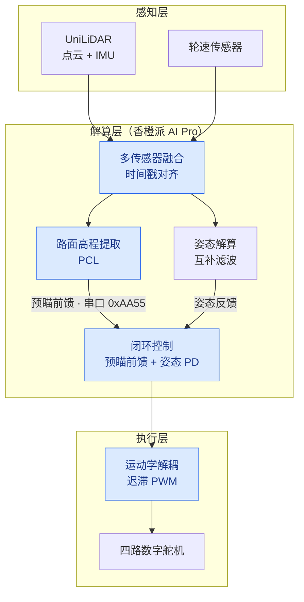
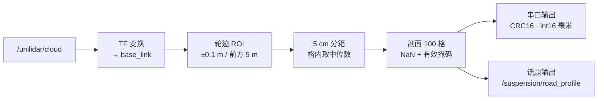
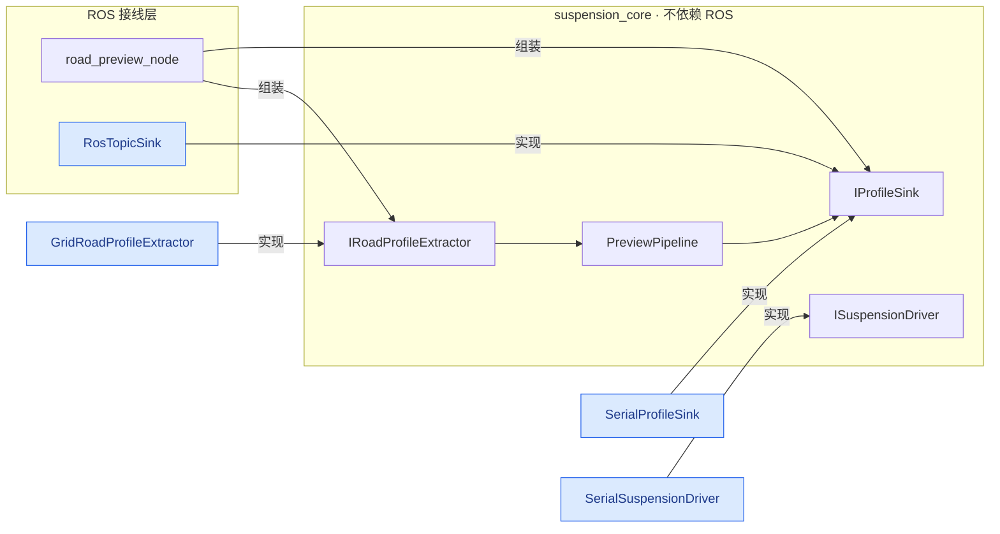
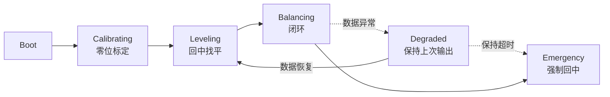

# 基于激光雷达路面预瞄的主动悬架系统

国家级大学生创新训练计划项目 · Active Suspension with LiDAR Preview

ROS2 · C++ · PCL · 嵌入式 · 多传感器融合

[English](README.en.md) | 简体中文

## 项目简介

一套基于激光雷达路面预瞄的主动悬架系统。以 ROS2 为框架、香橙派 AI Pro 为车载计算平台，通过激光雷达提前感知
车前路面高程，融合 IMU 姿态反馈，驱动四轮独立数字舵机实时调节悬架，在非结构化路面上抑制车身振动与姿态波动。

与常见的反馈式悬架不同，本方案把路面信息提前 5 m 拿到手，从源头绕开了"先颠簸、后补偿"的滞后问题。

### 硬件平台

| 部件 | 型号 / 规格 | 用途 |
|------|-------------|------|
| 激光雷达 | UniLiDAR（宇树） | 点云与 IMU 数据源 |
| 车载计算 | 香橙派 AI Pro（8 TOPS） | 点云处理与实时控制 |
| 作动器 | 数字舵机 × 4 | 四轮独立悬架调节 |
| 整车样机 | 400 × 300 × 200 mm | 3–8 km/h 稳定行驶 |
| 验证平台 | 传送带式单轮台架 | 模拟不同车速与路面 |

## 系统架构



蓝色节点是本仓库已实现的部分：感知与解算层由 `suspension_preview_v2` 提供，闭环控制与运动学
解耦由 `suspension_control_v3` 提供。四路舵机的实物驱动对接在 `ISuspensionDriver` 之下，
具体指令需按实际作动器的协议确认。

### 预瞄节点数据流



控制节点以 200 Hz（5 ms）周期运行。状态机在 `suspension_control_v3` 中实现，除论文给出的
`CALIBRATING → LEVELING → BALANCING` 外，还包含数据异常时的降级与急停处理。

## 仓库结构

```
active-suspension-lidar-preview/
├── src/
│   ├── suspension_preview/        初版预瞄节点（C++）
│   ├── suspension_preview_v2/     v2 接口化版本：核心库 + 两个节点 + 离线示例
│   ├── suspension_control_v3/     v3 闭环控制：输入校验 + 安全状态机 + 控制器 + 离线自检
│   └── car_balancer/              早期姿态平衡包（Python）
└── docs/
    ├── paper/                     项目论文（文字版）
    └── review/                    v1 代码审查报告、v2 升级说明
```

## 模块说明

### suspension_preview — 初版预瞄节点

`src/preview_node.cpp` 完成从点云到串口下发的整条链路：

1. 订阅 `/unilidar/cloud`；
2. TF 变换到 `base_link`；
3. PCL `PassThrough` 裁出左右轮迹（±10 cm）与车前 0–5 m；
4. 5 cm 网格提取路面高程剖面（100 点）；
5. 按自定义 `0xAA55` 协议经串口（115200 bps）下发。

参数写在文件顶部的宏里，改动需重新编译。

### suspension_preview_v2 — 接口化版本

在 v1 基础上做了三件事：把点云解析、输出、悬架驱动封装为接口；把与 ROS 无关的部分抽成独立的
`suspension_core` 库（可离线复用与测试）；修正 v1 的 QoS 兼容、串口 raw 模式、TF 失败兜底、
无效格静默填 0 等问题。



| 接口 | 职责 | 实现 |
|------|------|------|
| `IRoadProfileExtractor` | 点云解析：点云 → 左右轮迹高程剖面 | `GridRoadProfileExtractor` |
| `IProfileSink` | 输出：把剖面送出去 | `RosTopicSink`、`SerialProfileSink` |
| `ISuspensionDriver` | 悬架驱动：模式、目标高度、急停 | `SerialSuspensionDriver` |
| `PreviewPipeline` | 组装：解析并分发 | — |

细节见包内 `README.md` 与 `docs/review/02-v2-upgrade-notes.md`。

### suspension_control_v3 — 闭环控制与安全状态机

把 v2 提取出的路面剖面真正用来控制作动器输出。控制核心不依赖 ROS、不依赖 PCL，
可脱离整车单独编译与自检。



| 接口 | 职责 |
|------|------|
| `IInputValidator` | 剖面校验，拒绝 9 类坏数据（NaN、超范围、质量不足、间距与轮距非法、坐标系不符、时间戳过旧、帧间跳变过大等） |
| `ISafetyStateMachine` | 安全状态机与三分支输出契约：用控制器输出 / 保持上次值 / 强制回中 |
| `IController` | 预瞄前馈 + 无导数 PD + 运动学解耦 + 限幅与速率限制 |
| `IControlLoop` | 把校验、状态机、控制器、驱动器串成一条链 |

几个值得单独说明的设计：

- **零位标定**：静止时测姿态基准，车停在斜坡上也能正确判断"什么是水平"
- **降级有时限**：数据断流超过 5 s 转急停回中，不让作动器一直停在旧行程上
- **急停锁存**：需先解除急停再复位，对应实物"急停按钮已复位"
- **单周期时长封顶**：定时抖动不会把累计时长判据一次性推过阈值造成误动作
- **硬件急停**：进入急停时同时调用驱动器的 `emergency_stop()`，而不只是下发零位指令

离线自检 89 项，不需要 ROS 与硬件：

```bash
ros2 run suspension_control_v3 control_selftest
```

包内 `tools/lqr_gain_design.py` 可按性能指标反解 LQR / 增量式 LQI 增益，
把"试凑 kp/kd"换成按指标求解。细节见包内 `README.md`。

### car_balancer — 早期姿态平衡包

`test_imu_node.py` 订阅 `/unilidar/imu`，每 50 条消息打印一次四元数、角速度、线加速度，用于联调验证。

```bash
ros2 run car_balancer test_imu_node
```

`setup.py` 原先两条 entry point 之间缺逗号被隐式拼接，且 `test_imu_node.py` 不在模块目录内，
两个入口都无法运行，现已修复。另一条 `balancer_node` 指向的模块未随包提供，已移除该入口。
问题记录见 `docs/review/01-code-review-v1.md`。

## 快速开始

```bash
# 1. 工作空间准备：把本仓库的三个包放到 src/ 下，与 unitree_lidar_sdk 同级
mkdir -p ~/ws/src && cd ~/ws/src
git clone https://github.com/qi-neo/active-suspension-lidar-preview
git clone https://github.com/unitreerobotics/unitree_lidar_sdk

# 2. 编译
cd ~/ws
colcon build --packages-select suspension_preview suspension_preview_v2 suspension_control_v3
source install/setup.bash

# 3. 运行 v2（先只发话题，不接硬件）
ros2 launch suspension_preview_v2 preview_v2.launch.py enable_serial:=false
ros2 topic echo /suspension/road_profile --once

# 4. 运行 v3 闭环控制（不接硬件时只计算不下发）
ros2 launch suspension_control_v3 control_v3.launch.py enable_driver:=false
```

两个包都提供不依赖 ROS 的离线验证，可在没有硬件时确认链路是否正常：

```bash
ros2 run suspension_preview_v2 offline_demo        # 点云解析链路
ros2 run suspension_control_v3 control_selftest    # 控制与安全逻辑，89 项检查
```

依赖：ROS2（推荐 Humble / Jazzy）、`rclcpp`、`sensor_msgs`、`pcl_ros`、`pcl_conversions`、`tf2_ros`，
以及 [Unitree Lidar SDK](https://github.com/unitreerobotics/unitree_lidar_sdk)。

## 关键参数

| 参数 | v1 | v2 | 说明 |
|------|----|----|------|
| 预瞄距离 | `PREVIEW_DIST` 宏 | `preview_dist` | 5.0 m |
| 纵向分辨率 | 写死 5 cm | `resolution` | 格数由二者推导 |
| 轮迹宽度 | 写死 ±10 cm | `lane_half_width` | 0.1 m |
| 地面高程窗口 | 写死 ±0.5 m | `ground_z_min/max` | 需按坐标系定义核对 |
| 格内统计量 | 均值 | `use_median` | 默认中位数 |
| 串口 | `/dev/ttyS0` @115200 | `serial_port` / `baud_rate` | 可配到 921600 |
| 参数方式 | 宏定义，需重编译 | YAML + launch | 运行时生效 |

## 实测结果

实车 A/B 测试（主动对比被动）：

| 指标 | 被动 | 主动 | 改善 |
|------|------|------|------|
| 车身横滚角波动 | −5.87° ~ +6.12° | −1.15° ~ +1.08° | **81.4%** |
| 车身俯仰角波动 | −4.95° ~ +5.20° | −0.90° ~ +0.95° | **81.7%** |
| Z 轴加速度干扰 | 0.85g ~ 1.15g | 0.94g ~ 1.06g | **60.0%** |

姿态控制器的核心方法：

- 重力自适应标定：施密特正交化建立虚拟水平面，静止判定 σ_a < 0.05g、σ_g < 0.015°/s；
- 多级抗噪滤波：一阶低通（α_g=0.08，α_a=0.05）→ 滑动平均（窗 40）→ 互补滤波（α=0.992）→ 软死区（0.25°）；
- 无导数 PD：以陀螺仪角速度代替误差微分，避免噪声放大，整定 Kp=1.85、Kd=0.85；
- 运动学解耦与迟滞 PWM：消除末端高频微震。

论文原文为 PDF（已脱敏），文字版见 `docs/paper/`。

## 下行带宽

每帧发送左右两条轮迹，各 100 点：

| 版本 | 单条轮迹帧长 | 每帧合计 | 115200 bps | 460800 bps |
|------|-------------|---------|-----------|-----------|
| v1 | 405 B（float32 + 累加和） | 810 B | 约 14 帧/s | 不支持 |
| v2 | 208 B（int16 毫米 + CRC16） | 416 B | 约 28 帧/s | 约 111 帧/s |

v1 在 115200 bps 下的上限与雷达 10–20 Hz 的输出正好对冲，这是 v2 改用 int16 与提高波特率选项的原因。

## 常见问题

**收不到点云，节点启动后没有输出**
订阅端 QoS 与发布端不匹配。雷达通常以 `BEST_EFFORT` 发布，订阅端必须用 `SensorDataQoS`；
v1 使用默认 QoS（`RELIABLE`），是收不到数据的常见原因。

**串口打开失败**
设备权限问题。把当前用户加入 `dialout` 组后重新登录：`sudo usermod -aG dialout $USER`，
不要用 `chmod 777`。

**下发的高程数据在下游解析出错**
先确认波特率与帧格式。v2 与 v1 的帧格式不兼容（v1 是 float32 加 8 位累加和，v2 是 int16 毫米加 CRC16），
下游解析代码需要同步更新。

**剖面里出现 NaN 或 0x7FFF**
说明该格被判定为无效：点数不足、格内高低差超过 `max_cell_spread`（疑似障碍物），或落在
`ground_z_min/max` 窗口之外。需要时打开 `interpolate_gaps` 做线性插值。

**TF 报错或一直不发数据**
v2 在取不到 TF 时会丢弃该帧而不是继续下发。检查 `base_link` 与雷达坐标系之间的变换是否已发布，
必要时放宽 `tf_timeout_ms`。

## 许可证

[MIT](LICENSE)。转载或二次开发请保留出处；论文与硬件设计版权归项目团队所有。

## English Abstract

**Active Suspension with LiDAR Preview** — a National College Student Innovation Training Program.

A low-cost active suspension system that previews the road profile ahead of the vehicle with a LiDAR and suppresses
body vibration on unstructured terrain through IMU-feedback multi-stage anti-noise filtering (Gram-Schmidt gravity
calibration, complementary filter, derivative-free PD, kinematic decoupling, hysteresis PWM).

`suspension_preview` extracts left/right wheel-track road-height profiles from the UniLiDAR point cloud and streams
them over UART to the actuator controller. `suspension_preview_v2` refactors the parsing, output and actuator-driving
logic into reusable interfaces backed by a ROS-independent core library, adds a CRC16/int16 serial protocol, and
publishes the profile as a ROS topic with rviz visualization. See `docs/paper/` for the full paper and
`docs/review/` for the code review and upgrade notes.
