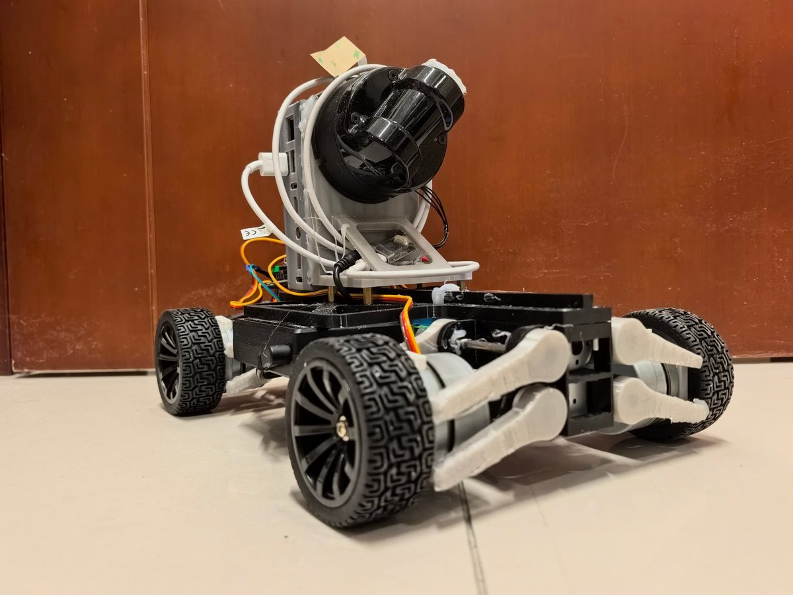
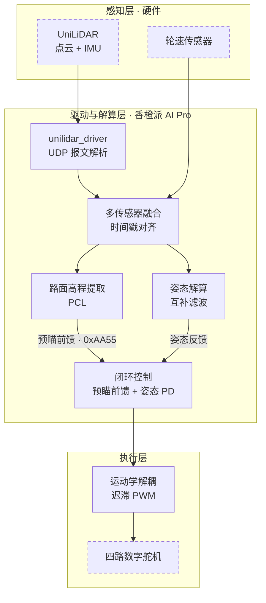
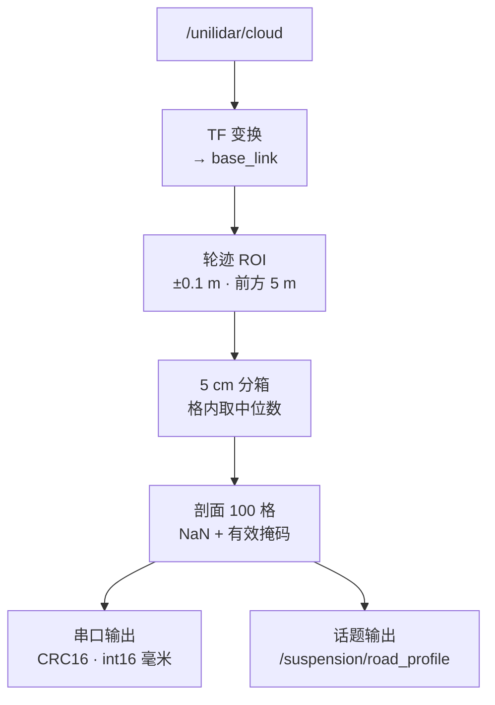
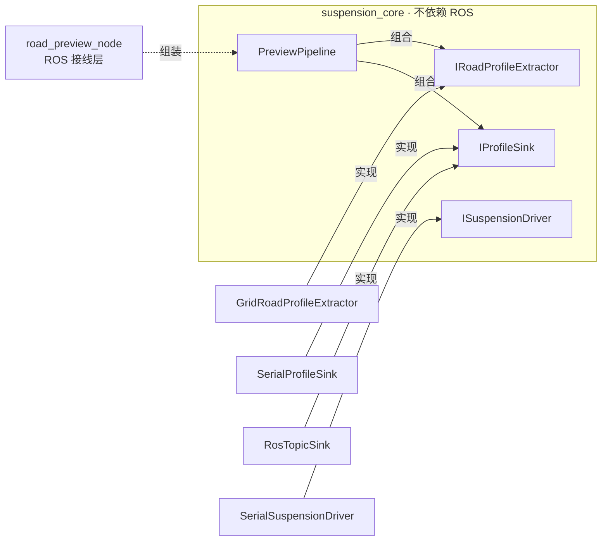
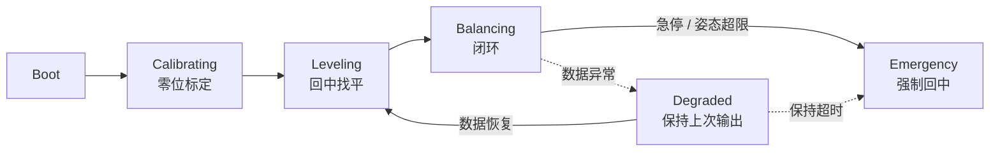
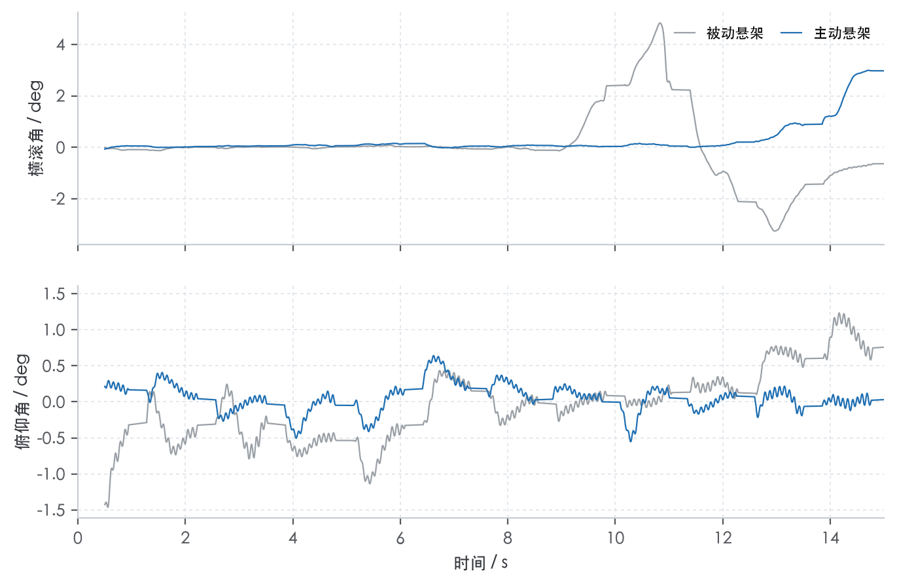
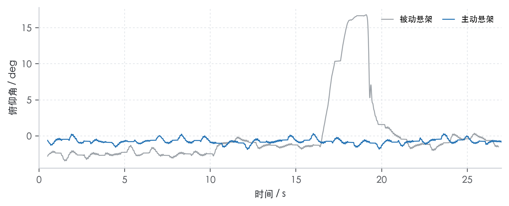
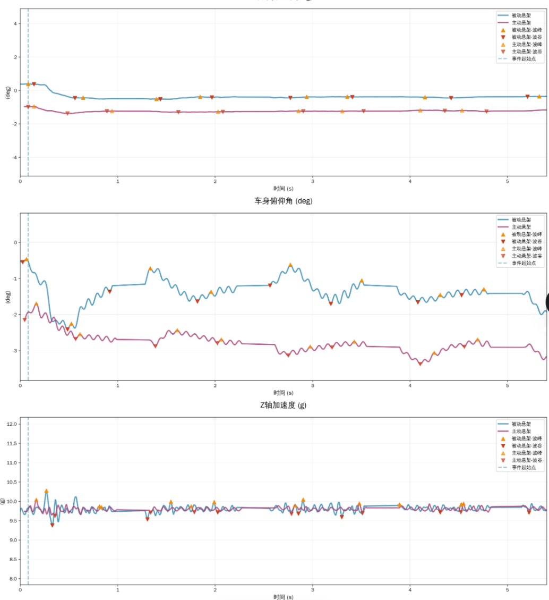

<div align="center">

# 基于激光雷达路面预瞄的主动悬架系统

**国家级大学生创新训练计划项目** · Active Suspension with LiDAR Preview

激光雷达随车速自适应预瞄路面高程（0.5–5 m），融合 IMU 姿态反馈，驱动四轮独立数字舵机实时调节悬架，抑制非结构化路面上的车身振动与姿态波动。

[](https://github.com/qi-neo/active-suspension-lidar-preview/actions/workflows/ros-ci.yml)
[](LICENSE)
[](https://docs.ros.org/en/humble/)
[](https://isocpp.org/)
[](#硬件平台)

[English](README.en.md) | 简体中文 | **[五分钟上手](QUICKSTART.md)**

</div>

> **要点**
>
> - 实车 A/B 测试：车身横滚、俯仰角波动各降约 81%，Z 轴加速度干扰降 60%
> - 自研宇树 L1 的 UDP 报文解析与几何换算，不链接官方静态库，可直接顶替官方节点
> - 控制核心不依赖 ROS 与 PCL，可脱离整车单独编译自检；安全状态机含降级与急停两条异常分支

> CI 在 ROS Humble 容器里 `colcon build` 五个包，并跑四组离线自检（v3 控制 346 项、驱动解析 63 项、
> v2 纯函数 69 项、虚拟水平面 69 项，共 547 项）。v3.1.0 之前的 tag 无法在干净环境构建，细节见 [CHANGELOG](CHANGELOG.md)。

> **刚拿到代码？** 先看 [QUICKSTART.md](QUICKSTART.md)——一条 `g++` 命令、几秒钟，
> 不需要 ROS 和硬件就能确认这套代码是完整可跑的（346 项检查）。

## 目录

1. [项目简介](#1-项目简介)
2. [系统架构](#2-系统架构)
3. [仓库结构](#3-仓库结构)
4. [模块说明](#4-模块说明)
    - [unilidar_driver](#unilidar_driver--宇树-l1-激光雷达驱动)
    - [suspension_preview](#suspension_preview--初版预瞄节点历史版本)
    - [suspension_preview_v2](#suspension_preview_v2--接口化版本)
    - [suspension_control_v3](#suspension_control_v3--闭环控制与安全状态机)
    - [car_balancer](#car_balancer--早期姿态平衡包)
5. [快速开始](#5-快速开始)
6. [关键参数](#6-关键参数)
7. [实测结果](#7-实测结果)
8. [下行带宽](#8-下行带宽)
9. [常见问题](#9-常见问题)
10. [许可证](#10-许可证)
11. [English Abstract](#11-english-abstract)

## 1. 项目简介

一套基于激光雷达路面预瞄的主动悬架系统。以 ROS2 为框架、香橙派 AI Pro 为车载计算平台，通过激光雷达提前感知
车前路面高程，融合 IMU 姿态反馈，驱动四轮独立数字舵机实时调节悬架，在非结构化路面上抑制车身振动与姿态波动。

与常见的反馈式悬架不同，本方案把路面信息提前拿到手（取样距离随车速在 0.5–5 m 间自适应），
从源头绕开了"先颠簸、后补偿"的滞后问题。

<p align="center"></p>
<p align="center"><sub>整车样机实拍：四轮独立数字舵机，香橙派 AI Pro 车载计算，400 × 300 × 200 mm</sub></p>

### 硬件平台

| 部件 | 型号 / 规格 | 用途 |
|------|-------------|------|
| 激光雷达 | UniLiDAR（宇树） | 点云与 IMU 数据源 |
| 车载计算 | 香橙派 AI Pro（8 TOPS） | 点云处理与实时控制 |
| 作动器 | 数字舵机 × 4 | 四轮独立悬架调节 |
| 整车样机 | 400 × 300 × 200 mm | 3–8 km/h 稳定行驶 |
| 验证平台 | 传送带式单轮台架 | 模拟不同车速与路面 |

## 2. 系统架构



虚线框为硬件，其余为本仓库实现的模块：感知层的报文解析由 `unilidar_driver` 提供，感知与解算层由
`suspension_preview_v2` 提供，闭环控制与运动学解耦由 `suspension_control_v3` 提供。四路舵机的
实物驱动对接在 `ISuspensionDriver` 之下，具体指令需按实际作动器的协议确认。

### 预瞄节点数据流



控制节点以 200 Hz（5 ms）周期运行。状态机在 `suspension_control_v3` 中实现，除论文给出的
`CALIBRATING → LEVELING → BALANCING` 外，还包含数据异常时的降级与急停处理。

## 3. 仓库结构

```
active-suspension-lidar-preview/
├── src/
│   ├── unilidar_driver/             宇树 L1 雷达驱动：自研 UDP 协议解析，发布点云与 IMU
│   ├── suspension_preview/          初版预瞄节点（C++）
│   ├── suspension_preview_v2/       v2 接口化版本：核心库 + 两个节点 + 离线示例
│   ├── suspension_control_v3/       v3 闭环控制：输入校验 + 安全状态机 + 控制器 + 离线自检
│   └── car_balancer/                早期姿态平衡包（Python）
└── docs/
    ├── paper/                       项目论文（文字版）
    └── review/                      v1 代码审查报告、v2 升级说明
```

## 4. 模块说明

### unilidar_driver — 宇树 L1 激光雷达驱动

点云与 IMU 原本依赖官方 `unitree_lidar_sdk` 的预编译静态库，看不到也改不了
解析逻辑。这个包自行实现了 Unitree L1 的 UDP 报文解析与几何换算，发布标准
`/unilidar/cloud`（PointCloud2）与 `/unilidar/imu`（Imu）话题，可直接顶替
官方节点，其他包零改动。

报文定界只用「帧尾标识 + CRC32」，不拿整包长度当判据——官方协议头文件里的
字节数注释与其自身字段并不一致（3D 点云整包注释 1036，按字段实算 1044），
硬编码长度会把新固件的包整批判坏。配套的 `udp_probe` 探针用来在真机上核对
真实包长与 CRC 是否成立。解析核心不依赖 ROS，可在任意机器上编译自检。

相对官方节点还修掉一处 QoS 不兼容：官方按 RELIABLE 发布，而 v3 控制节点用
`SensorDataQoS`（BEST_EFFORT）订阅，两者不兼容会表现为「明明在发却收不到」。
本包统一按 `SensorDataQoS` 发布。

> **本包已独立成仓**：[qi-neo/unilidar-driver](https://github.com/qi-neo/unilidar-driver)。
> 雷达驱动是可复用资产，与主动悬架没有必然关系，故单独维护。本仓库内保留一份副本，
> 便于单独 clone 本仓库时直接 `colcon build`；**改动请以独立仓库为准，再同步回来**。
> 独立仓库另附 [`docs/driver-design.md`](https://github.com/qi-neo/unilidar-driver/blob/main/docs/driver-design.md)，
> 讲驱动编写的通用思路（职责边界、四层架构、帧定界怎么选、不接硬件怎么验证）。

细节、实机确认步骤与验证范围见
[`src/unilidar_driver/README.md`](src/unilidar_driver/README.md)。

### suspension_preview — 初版预瞄节点（历史版本）

> 已被 `suspension_preview_v2` 取代，保留用于复现论文里描述的初版行为。
> 新用途请用 v2。

`src/preview_node.cpp` 完成从点云到串口下发的整条链路：

1. 订阅 `/unilidar/cloud`；
2. TF 变换到 `base_link`；
3. PCL `PassThrough` 裁出左右轮迹（±10 cm）与车前 0–5 m；
4. 5 cm 网格提取路面高程剖面（100 点）；
5. 按自定义 `0xAA55` 协议经串口（115200 bps）下发。

参数写在文件顶部的宏里，改动需重新编译。已知四类问题（订阅端 QoS、串口未置
raw 模式、TF 失败无兜底、无效格静默填 0）均已在 v2 修复，详见包内 `README.md`
与 `docs/review/01-code-review-v1.md`。

### suspension_preview_v2 — 接口化版本

在 v1 基础上做了三件事：把点云解析、输出、悬架驱动封装为接口；把与 ROS 无关的部分抽成独立的
`suspension_core` 库（可离线复用与测试）；修正 v1 的 QoS 兼容、串口 raw 模式、TF 失败兜底、
无效格静默填 0 等问题。



| 接口 | 职责 | 实现 |
|------|------|------|
| `IRoadProfileExtractor` | 点云解析：点云 → 左右轮迹高程剖面 | `GridRoadProfileExtractor` |
| `IProfileSink` | 输出：把剖面送出去 | `RosTopicSink`、`SerialProfileSink` |
| `ISuspensionDriver` | 悬架驱动：模式、目标高度、急停 | `SerialSuspensionDriver` |
| `PreviewPipeline` | 组装：解析并分发 | — |

细节见包内 `README.md` 与 `docs/review/02-v2-upgrade-notes.md`。

### suspension_control_v3 — 闭环控制与安全状态机

把 v2 提取出的路面剖面真正用来控制作动器输出。控制核心不依赖 ROS、不依赖 PCL，
可脱离整车单独编译与自检。



| 接口 | 职责 |
|------|------|
| `IInputValidator` | 剖面校验，拒绝 9 类坏数据（NaN、超范围、质量不足、间距与轮距非法、坐标系不符、时间戳过旧、帧间跳变过大等） |
| `ISafetyStateMachine` | 安全状态机与三分支输出契约：用控制器输出 / 保持上次值 / 强制回中 |
| `IController` | 预瞄前馈（车速自适应 + 前后轴差异化）+ 无导数 PD + 运动学解耦 + 限幅与速率限制 |
| `IControlLoop` | 把校验、状态机、控制器、驱动器串成一条链 |

几个值得单独说明的设计：

- **零位标定**：静止时测姿态基准，车停在斜坡上也能正确判断"什么是水平"
- **降级有时限**：数据断流超过 5 s 转急停回中，不让作动器一直停在旧行程上
- **急停锁存**：需先解除急停再复位，对应实物"急停按钮已复位"
- **单周期时长封顶**：定时抖动不会把累计时长判据一次性推过阈值造成误动作
- **硬件急停**：进入急停时同时调用驱动器的 `emergency_stop()`，而不只是下发零位指令

<details>
<summary>前馈取样距离上的四处算法细节（v3.2.0 起，点击展开）</summary>

- **距离随车速自适应**：取样距离 = clamp(车速 × 响应时域, 0.5 m, 5 m)，响应时域取作动器
  走满行程耗时的 2.5 倍（默认 40 mm / 300 mm/s × 2.5 ≈ 0.33 s）。固定距离在低速时
  取样点落到有效范围外，高速时则根本来不及——论文实验车速 0.5 m/s，固定 1 m
  相当于提前 2 s 取路面。没有车速信息（未接 `/odom`）时自动退回固定 `lookahead_m`
- **前后轴差异化**：后轴取样距离比前轴短一个轴距——后轮比前轮晚一个"轴距/车速"
  的时间遇到同一路面特征，用同一距离会让俯仰前馈拿超前路面去压后轮
- **帧龄运动补偿**：剖面坐标系锚定在采集时刻的车体原点，车在帧龄内已经前进
  车速×帧龄，取样位置把这个距离加回去。剖面 10~20 Hz、帧龄常年 50~100 ms，
  2 m/s 时不补偿就是 100~200 mm 的系统性偏差。实际取样位置
  （= 生效距离 + 补偿）每拍写进 `ControlStatus.sample_position_m`
- **括号格插值与跨侧回退**：取样在相邻格间线性插值，避免 5 cm 量化形成台阶式
  行程指令；单侧轮迹无有效数据时借对侧高程，避免左右不对称的伪横滚指令
  （该情况在 `ControlStatus.feedforward_fallback` 置位，可观测）

</details>

生效的车速、取样距离、帧龄每拍写进 `ControlStatus`
（`speed_mps` / `lookahead_m` / `profile_age_ms` / `sample_position_m`），
联调时能直接看到"前馈到底按多远取了样"。

离线自检 346 项，不需要 ROS 与硬件：

```bash
ros2 run suspension_control_v3 control_selftest
```

包内 `tools/lqr_gain_design.py` 可按性能指标反解 LQR / 增量式 LQI 增益，
把"试凑 kp/kd"换成按指标求解。细节见包内 `README.md`。

### car_balancer — 早期姿态平衡包

`test_imu_node.py` 订阅 `/unilidar/imu`，每 50 条消息打印一次四元数、角速度、线加速度，用于联调验证。

```bash
ros2 run car_balancer test_imu_node
```

`setup.py` 原先两条 entry point 之间缺逗号被隐式拼接，且 `test_imu_node.py` 不在模块目录内，
两个入口都无法运行，现已修复。另一条 `balancer_node` 指向的模块未随包提供，已移除该入口。
问题记录见 `docs/review/01-code-review-v1.md`。

## 5. 快速开始

```bash
# 1. 工作空间准备：把本仓库放到 src/ 下
mkdir -p ~/ws/src && cd ~/ws/src
git clone https://github.com/qi-neo/active-suspension-lidar-preview
# 如果还想用官方节点做对照，再 clone 官方 SDK（本仓库的驱动不依赖它）
# git clone https://github.com/unitreerobotics/unitree_lidar_sdk
# 雷达驱动另有独立仓库（含驱动编写思路文档），二者内容一致，按需选用：
# git clone https://github.com/qi-neo/unilidar-driver

# 2. 编译
cd ~/ws
colcon build --packages-select unilidar_driver suspension_preview suspension_preview_v2 suspension_control_v3
source install/setup.bash

# 3. 接真实雷达：先跑探针确认能收到、真实包长是多少（详见驱动包 README）
ros2 run unilidar_driver udp_probe --port 6201 --seconds 5 --hex

# 4. 跑驱动，顶替官方节点
ros2 launch unilidar_driver unilidar_driver.launch.py

# 5. 运行 v2 预瞄（先只发话题，不接硬件）
ros2 launch suspension_preview_v2 preview_v2.launch.py enable_serial:=false
ros2 topic echo /suspension/road_profile --once

# 6. 运行 v3 闭环控制（不接硬件时只计算不下发）
ros2 launch suspension_control_v3 control_v3.launch.py enable_driver:=false
```

四个包都提供不依赖 ROS 的离线验证，可在没有硬件时确认链路是否正常：

```bash
ros2 run unilidar_driver decoder_selftest    # 报文解析，63 项检查
ros2 run suspension_preview_v2 offline_demo        # 点云解析链路
ros2 run suspension_preview_v2 level_selftest      # 虚拟水平面标定（重力正交化），69 项检查
ros2 run suspension_control_v3 control_selftest    # 控制与安全逻辑，346 项检查
```

依赖：ROS2（推荐 Humble / Jazzy）、`rclcpp`、`sensor_msgs`、`nav_msgs`、`pcl_ros`、`pcl_conversions`、`tf2_ros`。
雷达驱动包 `unilidar_driver` 额外需要 `tf2`、`tf2_ros`，**不依赖** Unitree Lidar SDK。

## 6. 关键参数

| 参数 | v1 | v2 | 说明 |
|------|----|----|------|
| 预瞄距离 | `PREVIEW_DIST` 宏 | `preview_dist` | 5.0 m |
| 纵向分辨率 | 写死 5 cm | `resolution` | 格数由二者推导 |
| 轮迹宽度 | 写死 ±10 cm | `lane_half_width` | 0.1 m |
| 地面高程窗口 | 写死 ±0.5 m | `ground_z_min/max` | 需按坐标系定义核对 |
| 格内统计量 | 均值 | `use_median` | 默认中位数 |
| 串口 | `/dev/ttyS0` @115200 | `serial_port` / `baud_rate` | 可配到 921600 |
| 参数方式 | 宏定义，需重编译 | YAML + launch | 运行时生效 |

## 7. 实测结果

实车 A/B 测试（主动对比被动）：

| 指标 | 被动 | 主动 | 改善 |
|------|------|------|------|
| 车身横滚角波动 | −5.87° ~ +6.12° | −1.15° ~ +1.08° | **81.4%** |
| 车身俯仰角波动 | −4.95° ~ +5.20° | −0.90° ~ +0.95° | **81.7%** |
| Z 轴加速度干扰 | 0.85g ~ 1.15g | 0.94g ~ 1.06g | **60.0%** |

<p align="center"></p>
<p align="center"><sub>图 1　常规路面工况（01）：横滚角与俯仰角，250 Hz 原始数据去均值、36 ms 滑动平均</sub></p>

<p align="center"></p>
<p align="center"><sub>图 2　越障工况（03）：俯仰角响应，主动悬架峰值明显收窄</sub></p>

<p align="center"></p>
<p align="center"><sub>图 3　项目论文图 1（实验 1）：被动与主动悬架性能指标对比</sub></p>

姿态控制器的核心方法：

- 重力自适应标定：施密特正交化建立虚拟水平面，静止判定 σ_a < 0.05g、σ_g < 0.015°/s；
- 多级抗噪滤波：一阶低通（α_g=0.08，α_a=0.05）→ 滑动平均（窗 40）→ 互补滤波（α=0.992）→ 软死区（0.25°）；
- 无导数 PD：以陀螺仪角速度代替误差微分，避免噪声放大，整定 Kp=1.85、Kd=0.85；
- 运动学解耦与迟滞 PWM：消除末端高频微震。

论文原文为 PDF（已脱敏），文字版见 `docs/paper/`。

## 8. 下行带宽

每帧发送左右两条轮迹，各 100 点：

| 版本 | 单条轮迹帧长 | 每帧合计 | 115200 bps | 460800 bps |
|------|-------------|---------|-----------|-----------|
| v1 | 405 B（float32 + 累加和） | 810 B | 约 14 帧/s | 不支持 |
| v2 | 208 B（int16 毫米 + CRC16） | 416 B | 约 28 帧/s | 约 111 帧/s |

v1 在 115200 bps 下的上限与雷达 10–20 Hz 的输出正好对冲，这是 v2 改用 int16 与提高波特率选项的原因。

## 9. 常见问题

<details>
<summary>收不到点云，节点启动后没有输出</summary>

订阅端 QoS 与发布端不匹配。雷达通常以 `BEST_EFFORT` 发布，订阅端必须用 `SensorDataQoS`；
v1 使用默认 QoS（`RELIABLE`），是收不到数据的常见原因。反过来也成立：`unilidar_driver`
统一按 `SensorDataQoS` 发布，就是为了与 v3 控制节点的订阅端对齐。

</details>

<details>
<summary>点云与 IMU 都收不到，但探针显示雷达在发包</summary>

先跑 `ros2 run unilidar_driver udp_probe --port 6201 --seconds 5 --hex` 核对本机 IP、端口
与雷达的目标地址是否对应；再看探针汇总里「整包长度分布」是否与驱动预期一致。

</details>

<details>
<summary>IMU 姿态看起来是错的</summary>

大概率是四元数分量顺序。官方未定死 `quaternion[4]` 的排列，官方 ROS2 包内部两种顺序都用过。
把雷达静止水平放置，正确的顺序下 `w` 接近 ±1、其余接近 0；判定方法见驱动包 README。

</details>

<details>
<summary>串口打开失败</summary>

设备权限问题。把当前用户加入 `dialout` 组后重新登录：`sudo usermod -aG dialout $USER`，
不要用 `chmod 777`。

</details>

<details>
<summary>下发的高程数据在下游解析出错</summary>

先确认波特率与帧格式。v2 与 v1 的帧格式不兼容（v1 是 float32 加 8 位累加和，v2 是 int16 毫米加 CRC16），
下游解析代码需要同步更新。

</details>

<details>
<summary>剖面里出现 NaN 或 0x7FFF</summary>

说明该格被判定为无效：点数不足、格内高低差超过 `max_cell_spread`（疑似障碍物），或落在
`ground_z_min/max` 窗口之外。需要时打开 `interpolate_gaps` 做线性插值。

</details>

<details>
<summary>TF 报错或一直不发数据</summary>

v2 在取不到 TF 时会丢弃该帧而不是继续下发。检查 `base_link` 与雷达坐标系之间的变换是否已发布，
必要时放宽 `tf_timeout_ms`。

</details>

## 10. 许可证

[MIT](LICENSE)。转载或二次开发请保留出处；论文与硬件设计版权归项目团队所有。

版本变更记录在 [`CHANGELOG.md`](CHANGELOG.md)。

## 11. English Abstract

<details>
<summary>点击展开英文摘要</summary>

**Active Suspension with LiDAR Preview** — a National College Student Innovation Training Program.

A low-cost active suspension system that previews the road profile ahead of the vehicle with a LiDAR and suppresses
body vibration on unstructured terrain through IMU-feedback multi-stage anti-noise filtering (Gram-Schmidt gravity
calibration, complementary filter, derivative-free PD, kinematic decoupling, hysteresis PWM).

`suspension_preview` extracts left/right wheel-track road-height profiles from the UniLiDAR point cloud and streams
them over UART to the actuator controller. `suspension_preview_v2` refactors the parsing, output and actuator-driving
logic into reusable interfaces backed by a ROS-independent core library, adds a CRC16/int16 serial protocol, and
publishes the profile as a ROS topic with rviz visualization. See `docs/paper/` for the full paper and
`docs/review/` for the code review and upgrade notes.

</details>
