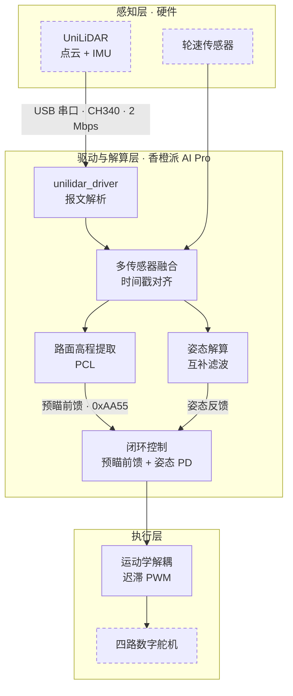
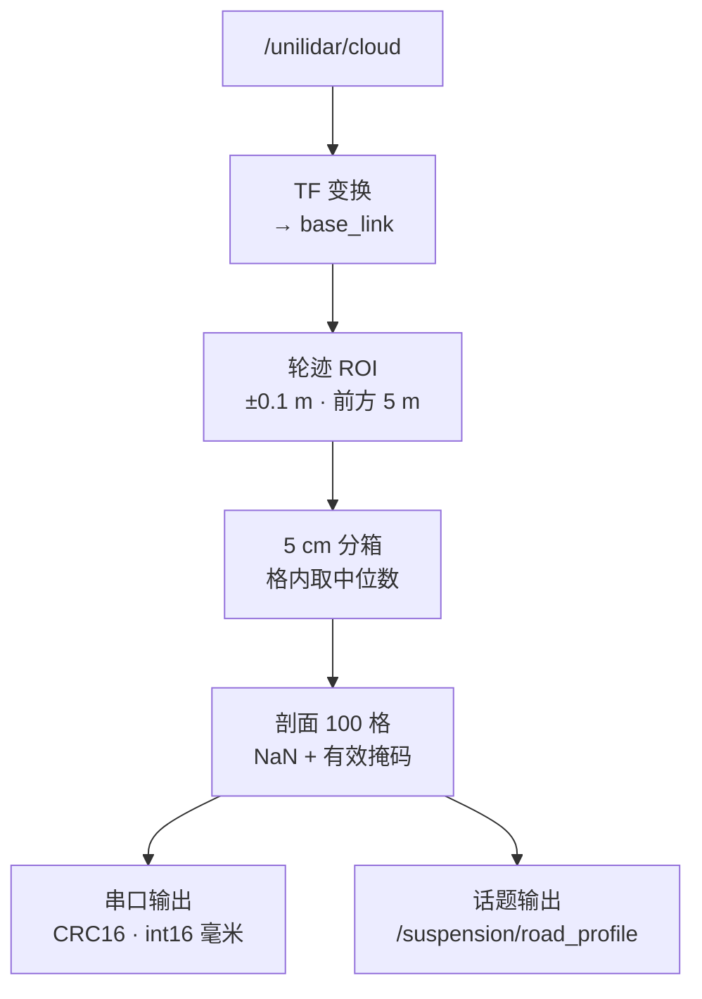
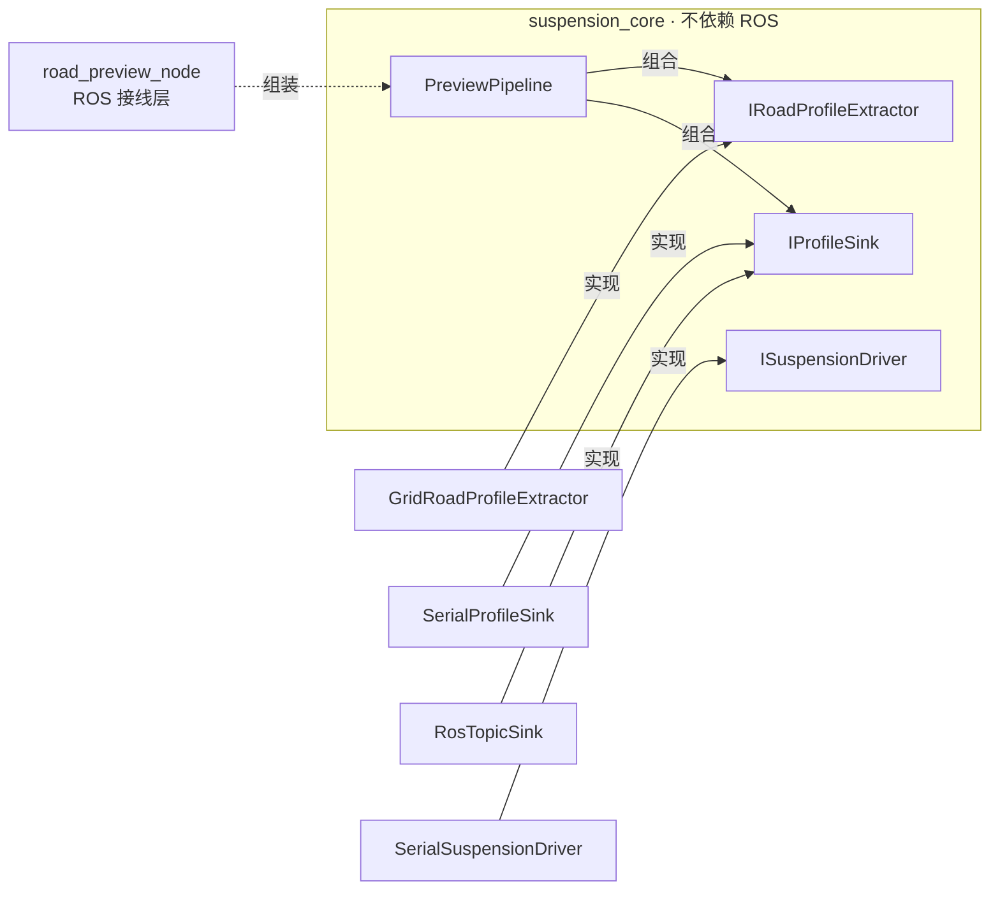
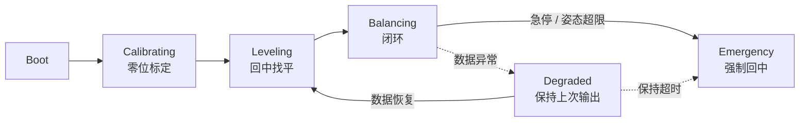

<div align="center">

# 基于激光雷达路面预瞄的主动悬架系统

**国家级大学生创新训练计划项目** · Active Suspension with LiDAR Preview

激光雷达随车速自适应预瞄路面高程（0.5–5 m），融合 IMU 姿态反馈，驱动四轮独立数字舵机实时调节悬架，抑制非结构化路面上的车身振动与姿态波动。

[](https://github.com/qi-neo/active-suspension-lidar-preview/actions/workflows/ros-ci.yml)
[](https://github.com/qi-neo/active-suspension-lidar-preview/actions/workflows/sanitizer.yml)
[](LICENSE)
[](https://docs.ros.org/en/humble/)
[](https://isocpp.org/)
[](#硬件平台)

[English](README.en.md) | 简体中文 | **[五分钟上手](QUICKSTART.md)**

</div>

> **要点**
>
> - 实车 A/B 测试（三次不同路段独立采集）：越障工况俯仰角波动降约 29%、Z 轴加速度干扰降约 38%；常规路面工况横滚/俯仰波动降约 12–21%（路面输入不完全一致，详见「实测结果」）
> - 自研宇树 L1 的报文解析与几何换算（串口/UDP 双传输，串口为实物默认路径），不链接官方静态库，可直接顶替官方节点
> - 控制核心不依赖 ROS 与 PCL，可脱离整车单独编译自检；安全状态机含降级与急停两条异常分支

> CI 在 ROS Humble 容器里 `colcon build` 五个包，再 `colcon test` 跑注册进 CTest 的自检，并跑六组离线自检（v3 控制 443 项、驱动报文解析 135 项、驱动串口接收 64 项、驱动串口压力 14 项、
> v2 纯函数 196 项、虚拟水平面 69 项，共 921 项）。v3.1.0 之前的 tag 无法在干净环境构建，细节见 [CHANGELOG](CHANGELOG.md)。

> **刚拿到代码？** 先看 [QUICKSTART.md](QUICKSTART.md)——一条 `g++` 命令、几秒钟，
> 不需要 ROS 和硬件就能确认这套代码是完整可跑的（443 项检查）。

## 目录

1. [项目简介](#1-项目简介)
    - [硬件设计 / Hardware](#硬件设计--hardware)
2. [系统架构](#2-系统架构)
    - [预瞄节点数据流](#预瞄节点数据流)
3. [快速开始](#3-快速开始)
    - [Rviz2 可视化验证](#rviz2-可视化验证)
    - [驱动默认参数 ↔ L1 官方规格对照](#驱动默认参数--l1-官方规格对照)
4. [仓库结构](#4-仓库结构)
5. [模块说明](#5-模块说明)
    - [unilidar_driver](#unilidar_driver--宇树-l1-激光雷达驱动)
    - [suspension_preview](#suspension_preview--初版预瞄节点历史版本)
    - [suspension_preview_v2](#suspension_preview_v2--接口化版本)
    - [suspension_control_v3](#suspension_control_v3--闭环控制与安全状态机)
    - [car_balancer](#car_balancer--早期姿态平衡包)
6. [接口参考 / Interface Reference](#6-接口参考--interface-reference)
7. [关键参数](#7-关键参数)
8. [实测结果](#8-实测结果)
9. [下行带宽](#9-下行带宽)
10. [常见问题](#10-常见问题)
11. [质量保障](#11-质量保障)
12. [许可证](#12-许可证)
13. [English Abstract](#13-english-abstract)

## 1. 项目简介

一套基于激光雷达路面预瞄的主动悬架系统。以 ROS2 为框架、香橙派 AI Pro 为车载计算平台，通过激光雷达提前感知
车前路面高程，融合 IMU 姿态反馈，驱动四轮独立数字舵机实时调节悬架，在非结构化路面上抑制车身振动与姿态波动。

与常见的反馈式悬架不同，本方案把路面信息提前拿到手（取样距离随车速在 0.5–5 m 间自适应），
从源头绕开了"先颠簸、后补偿"的滞后问题。

<p align="center"></p>
<p align="center"><sub>整车样机实拍：四轮独立数字舵机，香橙派 AI Pro 车载计算，400 × 300 × 200 mm</sub></p>

### 硬件平台

| 部件 | 型号 / 规格 | 用途 |
|------|-------------|------|
| 激光雷达 | **UniLiDAR L1**（宇树，4D LiDAR） | 点云与 IMU 数据源 |
| 车载计算 | 香橙派 AI Pro（8 TOPS） | 点云处理与实时控制 |
| 作动器 | **RDS3115 mg** 数字舵机 × 4 | 四轮独立悬架调节 |
| 整车样机 | 400 × 300 × 200 mm | 3–8 km/h 稳定行驶 |
| 验证平台 | 传送带式单轮台架 | 模拟不同车速与路面 |

#### UniLiDAR L1 规格（宇树官网）

| 项目 | 参数 |
|------|------|
| FOV（视场角） | **360° × 90°** 全向超广角 |
| 扫描方式 | 非接触无刷转镜扫描，非重复扫描 |
| 量程 | 30 m @90% 反射率 / 15 m @10%（L1 RM）；L1 PM 为 20 m / 10 m |
| 测量精度 | ±2.0 cm |
| 近处盲区 | 0.05 m |
| 采样 / 有效频率 | 43200 点/s（采样）· **21600 点/s（有效）** |
| 周向 / 竖直扫描频率 | **11 Hz / 180 Hz** |
| IMU | 3 轴加速度 + 3 轴陀螺仪 |
| 数据 | 4D：3D 位置 + 1D 灰度 |
| 通讯接口（官方标注） | **TTL UART** |
| 抗强光 | 100 Klux 以上 |
| 人眼安全 | Class 1（IEC60825-1:2014） |
| 功率 / 尺寸 / 重量 | 6 W · 75×75×65 mm · 230 g |
| 工作环境 | 室内 / 室外 |

> ✅ **通讯接口官方标注即 TTL UART**，与实物一致：样机经 **CH340 转接模块** 以 USB 串口接入香橙派（`/dev/ttyUSB0`，2 Mbps）。
> 以太网 UDP（雷达 `192.168.1.62:6101` → 主机 `192.168.1.2:6201`）是**备选**路径，需串口转 UDP 转接板或带网口版本。
> 供电电压官网本页未标注，按实物线标确认（勿凭猜上电）。

#### RDS3115 mg 舵机规格（实测表 + 商品页）

| 项目 | 参数 |
|------|------|
| 控制方式 | **PWM（脉宽调制）** |
| 脉宽范围 / 中点 | **500 ~ 2500 μs** / 中点 1500 μs |
| 控制角度 | 180°（500~2500 μs 时） |
| 死区 | 3 μs |
| 工作频率 | 50 ~ 330 Hz |
| 旋转方向 | 逆时针（500 → 2500 μs） |
| 工作电压 | 5 V / 6.8 V |
| 待机电流 | 4 mA / 5 mA |
| 空载转速 | 0.16 s/60° / 0.14 s/60° |
| 堵转扭矩 | 15 kg·cm / 17 kg·cm |
| 堵转电流 | **1.6 A / 2.5 A** |
| 齿轮 / 出线 | 金属齿（mg）· 3 线（红=正、黑或棕=负、黄或白=信号）· 3-pin JR 式插头 |

> ⚠️ **舵机是 PWM 控制，不是串口总线舵机。** 因此"舵机控制侧"必须把 `0xAA55` 里的**目标高度（mm）**换算成**舵机转角 / PWM 脉宽**——这一步依赖摇臂连杆的机械传动比，是软件与机械的接口，必须在台架上实测标定（见接线章节）。
> 四轮堵转时合计可达 ~10 A（2.5 A × 4），舵机电源必须独立于逻辑电源并留足余量。

#### 香橙派 AI Pro（8T）规格

| 项目 | 参数 |
|------|------|
| SoC | **昇腾 Ascend 310B**：4 核 64 位 ARM 应用处理器 + DaVinci AI core + 集成 GPU |
| AI 算力 | **8 TOPS INT8** |
| 内存 | LPDDR4X 8 GB / 16 GB（可选），3200 Mbps |
| 存储 | SPI flash 32 MB · MicroSD(TF) · eMMC 模块 32/64/128/256 GB（eMMC5.1 HS400）· M.2 2280 SATA/NVMe SSD |
| 网络 | 千兆以太网 10/100/1000 Mbps · Wi-Fi 5 双频 2.4G/5G · BT 4.2/BLE |
| 显示 / 摄像头 | 2× HDMI 2.0（4K@60FPS）· 1× 2-lane MIPI DSI · 2× 2-lane MIPI CSI（兼容树莓派摄像头） |
| USB | 2× USB 3.0 HOST · 1× USB Type-C 3.0 HOST · 1× **Micro USB（调试串口，经板载 CH343P）** |
| 40 pin 扩展口 | 26 个 GPIO，支持 **GPIO / UART / I2C / SPI / I2S / PWM** |
| 音频 / 按键 | 3.5 mm 耳机孔输入/输出、板载模拟麦克风 · 电源键、RESET、2× 启动方式拨动键、烧录键 |
| 其他 | 风扇接口 ×1 · 2-pin 电池接口（预留） |
| 电源 | **Type-C PD 20 V IN，标准 65 W** |
| 尺寸 / 重量 | 107 × 68 mm · 82 g |
| 操作系统 | Ubuntu、openEuler |

**串口 —— 直接关系本项目，务必留意**

- 开发板默认用 **uart0 作为调试串口**，在 Linux 下即 **`/dev/ttyS0`**——本项目舵机下行正是这个口。
- uart0 的 TX/RX **同时引到两处**：① **40 pin 扩展口的 8 号(TXD) 与 10 号(RXD) 引脚**；② 板载 **CH343P** 芯片 → **Micro USB** 接口。
- 官方明确要求：**两种方式二选一，不可同时使用**。调试串口波特率 115200。
- 40 pin 上所有 GPIO 电平为 **3.3 V**；**27/28 号引脚只有 I2C 功能且为 1.8 V**，不要当普通 GPIO 用。

> ⚠️ **对本项目的直接影响**：uart0 既是 console 又是舵机下行口。
> - 若同时用 Micro USB 看启动日志，内核/登录提示符的**字符会混进 `0xAA55` 数据流**，导致下游 CRC 校验连续失败；
> - 正式跑控制前应**关闭 uart0 上的 console**（改启动参数或改用其他串口做调试），否则下行帧会被污染；
> - 40 pin 的 **8/10 号引脚不要再复用为 GPIO**。

**关于 MCU**

- 昇腾 310B 集成的是 4 核 ARM **应用处理器** + DaVinci AI core + GPU，**板上没有独立的实时 MCU 协处理器**；板载 CH343P 仅是 USB-UART 桥接芯片，不承担控制任务。
- 所以 200 Hz 的确定性控制**无法由 Linux 侧保证**（见 `command_sink.hpp` 的说明：一次串口写阻塞就顶住整个控制回路）——
  这正是 [`hardware/main-control-board/`](hardware/main-control-board) P0 板要外挂 **STM32G4** 做实时协处理器的原因。

### 接线与物理接口

样机的物理连接只有**两条数据链路**（一路 USB 串口、一路 UART）加**两路供电**。接口类型、电气标准与协议如下。

```
                        ┌───────────────────────────────┐
      12 V 供电 ────────┤ 电源                          │
                        │        香橙派 AI Pro          │
                        │        （车载计算）           │
                        │                               │
                        │ USB  (/dev/ttyUSB0)           │
                        │ 2,000,000 bps ────────────────┼──► CH340 转接模块 ──► UniLiDAR L1
                        │                               │                          （点云 + IMU）
                        │ UART (/dev/ttyS0)             │
                        │ 115200 8N1 3.3V TTL ──────────┼──► 舵机控制侧 ──► 4 × RDS3115 舵机
                        │                               │                          （顺序 0/1/2/3）
                        │ 0xAA55 + CRC16                │
                        └───────────────────────────────┘
```

**接口总表**

| 链路 | 物理接口 | 电气标准 | 协议 | 关键参数 | 代码 / 配置项 |
|------|----------|----------|------|----------|---------------|
| 香橙派 ↔ UniLiDAR L1 | **USB（经 CH340 转接模块）** | **TTL UART → USB** | 私有报文 / MavLink 帧 | `/dev/ttyUSB0`，**2,000,000 bps**；需 `dialout` 权限 | 另见下方「以太网 UDP」备选 |
| L1 供电 | 直流 | 6 W（**电压按实物线标确认**，官网本页未标注） | — | 与舵机电源隔离、加反接 + TVS 保护 | `hardware/sensors-interface/` |
| 香橙派 ↔ 舵机控制侧 | UART（40 pin **8 号 TXD / 10 号 RXD**，即 `/dev/ttyS0`） | **3.3 V TTL** | 自定义 `0xAA55` 帧 | 115200 8N1（可配 921600）；raw 模式、关硬件流控、写满 + `tcdrain` | `serial_port` / `baud_rate` |
| 舵机控制侧 ↔ 4 × RDS3115 | 3-pin JR 插头（红 VCC / 黑 GND / 黄 PWM） | PWM 脉宽 | **500~2500 μs，中点 1500 μs，50~330 Hz** | 顺序 `0=左前 1=右前 2=左后 3=右后` | 封装在 `ISuspensionDriver` 之下 |
| 舵机供电 | 直流 | 5 V / 6.8 V | — | 堵转 2.5 A/路，四路需 ≥10 A 余量，**独立于逻辑电源** | — |

**1) 激光雷达 UniLiDAR L1 —— 走 USB 串口（CH340 转接），不是以太网**

L1 原生接口就是 **TTL UART**（官网参数表亦标注「通讯接口：TTL UART」），
宇树官方 SDK 的**默认**连接方式就是 USB 串口。样机接法：

```
L1 (TTL UART) ──► CH340 转接模块 ──► USB ──► 香橙派 USB 口 ──► /dev/ttyUSB0
```

- **设备名**：Linux 下通常枚举为 `/dev/ttyUSB0`（用 `ls /dev/ttyUSB*` 确认；多设备时序号会变，建议按 id 绑 udev 规则固定）。
- **波特率：`2,000,000 bps`**（官方 SDK 默认值）。这是为承载高频输出（IMU 100–1000 Hz、点云按 18 条扫描线聚合）而设的非常规波特率。
- **权限**：`sudo usermod -aG dialout $USER` 后重新登录（不要用 `chmod 777`）。
- **供电**：功率 6 W；**电压官网本页未标注，按实物线标确认后上电**（勿凭猜）。

> ⚠️ **CH340 与 2 Mbps 需实测**：CH340 标称支持到 2 Mbps，但 Linux 下走的是 `ch341` 驱动，
> 对 2 Mbps 这类非常规波特率的支持并非各版本都稳。若出现能识别设备但收不到数据/大量坏帧，
> 优先怀疑波特率与转接芯片（可换 CP2102 / FT232 对照），而不是雷达本身。

**备选路径：以太网 UDP。** 若采用「串口转 UDP 转接板」或带网口的 L1，数据会以 UDP 送达：
雷达 `192.168.1.62:6101` → 主机 `192.168.1.2:6201`。此时把驱动 `transport` 参数设为
`udp`，并用 `local_ip` / `local_port` / `source_ip` 配置。

> ✅ **两条路径驱动都已实现。** `unilidar_driver` 用 `transport` 参数切换：
> **`serial`（默认）** 经 `serial_receiver.hpp` 走 `/dev/ttyUSB0` @ 2 Mbps，
> 即上面的实物链路；`udp` 走 `udp_receiver.hpp`。串口接收有 64 项离线自检
> （`serial_receiver_selftest`，Linux 平台；macOS 本机为 63 项——`B2000000` 是
> Linux 扩展常量，没有它的平台跳过 2 Mbps 断言。PTY 虚拟串口，覆盖整帧直达、跨写拆包、
> 垃圾与伪帧头重同步、无数据契约、一次多帧、IMU 帧与打开失败路径）。
> 另有 14 项**压力自检**（`serial_stress_selftest`）：PTY 主端按 2 Mbps 灌入
> 合成报文，同时掺垃圾与伪帧头、周期性读暂停，断言灌入帧数 == 解出帧数、
> 零 CRC/帧尾/序号误判、缓冲与内存有界——本机 60 秒实测灌入 126,636 帧
> 全部解出。`packet_parser` 一个真 bug（坏帧后丢整帧）就是它最先抓到的。
> `packet_parser` 按「无边界字节流」设计（串口可能在任意位置开始接收），
> 两条路径喂给解析器的都是字节流，协议/解析层零改动。

- **报文处理链**：私有报文 → `packet_parser`（流式定界，UDP 可能丢包/提前截断、串口可能半帧残留）→ `frame_decoder` → 标准 `PointCloud2` + `Imu`。
- **节奏**：雷达约 180 Hz 出扫描线，`cloud_scan_num=18` 合成约 **10 Hz** 点云，与预瞄节点输入节奏匹配。
- **坐标系**：`unilidar_lidar` / `unilidar_imu` → `base_link`。
- **先跑探针再跑驱动**（仅 UDP 备选路径）：`ros2 run unilidar_driver udp_probe --port 6201 --seconds 5 --hex`，核对本机 IP/端口与包长分布。串口路径先用 `serial_receiver_selftest` 自检，再 `ls /dev/ttyUSB*` + `dialout` 权限上实物。
- ⚠️ **四元数顺序**：官方未定死，默认 `xyzw`。雷达静止水平放置时正确顺序下 `w ≈ ±1`、其余 ≈ 0——接线通电后第一件事就是验这个。

**2) 舵机下行 —— UART / `0xAA55`**

- **串口参数**：设备 `/dev/ttyS0`，115200 8N1（可配到 921600）。驱动按 raw 模式打开（`cfmakeraw`）、关硬件流控、阻塞写满后 `tcdrain`。
- **引脚与电平**：40 pin 的 **8 号 TXD / 10 号 RXD**，**3.3 V TTL**（40 pin 上所有 GPIO 均为 3.3 V）。
  若舵机控制侧是 5 V 逻辑，需加电平转换——3.3 V 输出通常能被 5 V 输入识别，但反向 5 V 灌入会**烧掉开发板 IO**，上电前务必确认。
- ⚠️ **uart0 同时是板载调试串口**（经 CH343P 引到 Micro USB）。官方要求两种用法**二选一**：跑控制时请关闭 uart0 上的 console，否则登录提示符等字符会混进 `0xAA55` 流导致 CRC 连续失败；也不要再复用 8/10 号引脚为 GPIO。
- **协议**：自定义 `0xAA55` 帧，细节见 [6.4 串口协议接口](#64-串口协议接口0xaa55)。
  - v2：`int16` 毫米 + CRC16-CCITT-FALSE
  - v1（历史）：`float32` + 8 位累加和 —— **两者不兼容**，下游解析须同步
- **权限**：`sudo usermod -aG dialout $USER` 后重新登录（不要用 `chmod 777`）。
- **带宽红线**：115200 bps 下单条轮迹的帧长与雷达 10–20 Hz 输出正好对冲，这正是 v2 改用 int16 并提供更高波特率选项的原因，详见 [第 9 章 下行带宽](#9-下行带宽)。

**3) 舵机侧 —— 已确认：PWM 舵机（RDS3115 mg）**

每路舵机 3 根线：`红=VCC` / `黑(棕)=GND` / `黄(白)=PWM 信号`，3-pin JR 式插头。控制侧输出 **4 路独立 PWM**：

| 项目 | 值 |
|------|-----|
| PWM 频率 | 50 ~ 330 Hz（常用 **50 Hz**，周期 20 ms） |
| 脉宽范围 | **500 ~ 2500 μs** |
| 中点（回中） | **1500 μs** |
| 对应角度 | 180°（500 → 2500 μs，逆时针） |
| 死区 | 3 μs（小于此的脉宽变化舵机不响应，不必追求更高 PWM 分辨率） |

**软件 ↔ 机械的换算接口（必须台架标定）**：`0xAA55` 下发的是**目标高度（mm）**，而舵机只认**脉宽**。
换算链是 `高度 mm → 摇臂转角 ° → PWM 脉宽 μs`，传动比由连杆机构决定，**无法从代码推出**。
标定方法：固定机构后实测若干组（目标高度 ↔ 脉宽）点对，拟合线性映射写入控制侧；换机构必须重标。

- 四轮顺序必须与固件枚举严格一致（`0=左前 1=右前 2=左后 3=右后`），逐个单轮下发验证升降方向后再装车。
- 舵机供电 5 V / 6.8 V，**堵转 2.5 A/路**，四路同动瞬态电流很大——电源独立并留 ≥10 A 余量，线径与压降要算。
- 堵转电流同时是**硬件急停 / 过流保护**的整定依据，也是 `safety_state_machine` 堵转判据的物理来源。
- 这一段在软件上被 `ISuspensionDriver` 封装：换作动器只需换实现，上层不动。

**4) 接线核对清单**

- [ ] L1 电压按实物线标确认；CH340 转接模块接香橙派 USB，`ls /dev/ttyUSB*` 能识别
- [ ] 串口波特率设为 **2,000,000** 且当前用户属 `dialout`；建议 udev 规则固定设备名
- [ ] 能稳定收数（若走 UDP 备选路径，则 `udp_probe` 收包且包长与预期一致）
- [ ] 串口设备存在、波特率与对端一致、当前用户属 `dialout`
- [ ] **关闭 `/dev/ttyS0`(uart0) 上的 console**，且不与 Micro USB 调试串口同时使用
- [ ] 40 pin 8/10 号脚确认为 TXD/RXD（3.3 V），未复用为 GPIO
- [ ] UART **必须共地**（香橙派 GND 与舵机控制侧 GND 相连）——浮地是最常见的"时通时不通"
- [ ] 舵机 PWM 频率与脉宽范围写入控制侧（500~2500 μs），**先不装连杆空载验证转向**
- [ ] 台架标定 `高度 mm ↔ PWM 脉宽` 映射，记录传动比
- [ ] 舵机电源（5/6.8 V，≥10 A 余量）与逻辑/算力电源分离并隔离
- [ ] 逐个单轮下发，验证顺序与升降方向与固件约定一致
- [ ] 急停链路独立于软件（见 `hardware/estop-watchdog-board/`）

### 硬件设计 / Hardware

把"飞线 + 开发板"的科研样机升级为可打样、带硬件安全链路的机电系统，并作为开源硬件补充进仓库。设计方案、BOM 与框图见 [`hardware/`](hardware/README.md)：

- **P0 主控 + 执行一体化板**：把确定性 200 Hz 舵机控制与 4 路 PWM 舵机输出从香橙派搬到 MCU（STM32G4），并原生解析现有下行协议（`0xAA55` + CRC16，`0x10/0x11/0x12` 命令），消除 `command_sink` 串口阻塞；
- **P1 电源 / EMC 板**：隔离舵机大电流与算力/传感，集中供电 + 反接/保险丝/共模扼流；
- **P2 硬件急停 / 看门狗板**：心跳丢失即切舵机电源，把 `safety_state_machine` 的 Emergency 做成硅级 fail-safe；
- **P3 传感器 / L1 接口板**：IMU/轮速信号调理 + 减振，UniLiDAR L1 转接与减振安装。

> 状态：**P0 已有可打开的 KiCad v8 + EasyEDA 工程**（自包含符号库、27 网络 / 34 元件、网表自洽；本机无 EDA 工具链，未跑 DRC）；P1–P3 为设计文档先行。全部严格对齐仓库软件接口的痛点与协议。

## 2. 系统架构



虚线框为硬件，其余为本仓库实现的模块：感知层的报文解析由 `unilidar_driver` 提供，感知与解算层由
`suspension_preview_v2` 提供，闭环控制与运动学解耦由 `suspension_control_v3` 提供。四路舵机的
实物驱动对接在 `ISuspensionDriver` 之下，具体指令需按实际作动器的协议确认。

图中 L1 → 驱动那条边是**实物链路**（USB 串口经 CH340，2 Mbps）；`unilidar_driver` 的
`serial` 传输（`transport` 默认值）正是为这条链路实现的，UDP 为备选，详见
「[接线与物理接口](#接线与物理接口)」。

### 预瞄节点数据流



控制节点以 200 Hz（5 ms）周期运行。状态机在 `suspension_control_v3` 中实现，除论文给出的
`CALIBRATING → LEVELING → BALANCING` 外，还包含数据异常时的降级与急停处理。

## 3. 快速开始

```bash
# 1. 工作空间准备：把本仓库放到 src/ 下
mkdir -p ~/ws/src && cd ~/ws/src
git clone https://github.com/qi-neo/active-suspension-lidar-preview
# 如果还想用官方节点做对照，再 clone 官方 SDK（本仓库的驱动不依赖它）
# git clone https://github.com/unitreerobotics/unilidar_sdk
# 雷达驱动另有独立仓库（含驱动编写思路文档），二者内容一致，按需选用：
# git clone https://github.com/qi-neo/unilidar-driver

# 2. 编译
cd ~/ws
colcon build --packages-select unilidar_driver suspension_preview suspension_preview_v2 suspension_control_v3
source install/setup.bash

# 3. 接真实雷达：先跑探针确认能收到、真实包长是多少（详见驱动包 README）
ros2 run unilidar_driver udp_probe --port 6201 --seconds 5 --hex

# 4. 跑驱动，顶替官方节点
ros2 launch unilidar_driver unilidar_driver.launch.py

# 5. 运行 v2 预瞄（先只发话题，不接硬件）
#    预瞄节点要求 base_link -> 雷达 的 TF，而本仓库没有别的包发布 base_link，
#    所以节点默认自己发一条静态变换（publish_static_tf）。安装量参数 mount_*
#    默认全 0（占位），启动日志会 WARN 提醒——务必按实车实测后填，否则坐标是错的。
ros2 launch suspension_preview_v2 preview_v2.launch.py enable_serial:=false
ros2 topic echo /suspension/road_profile --once

# 6. 运行 v3 闭环控制（不接硬件时只计算不下发）
ros2 launch suspension_control_v3 control_v3.launch.py enable_driver:=false
```

除历史包 `suspension_preview`（v1）外，各包都提供不依赖 ROS 的离线验证，可在没有硬件时确认链路是否正常：

```bash
ros2 run unilidar_driver decoder_selftest           # 报文解析与解码，135 项检查
ros2 run unilidar_driver serial_receiver_selftest   # 串口接收（PTY 虚拟串口），64 项检查（macOS 63）
ros2 run unilidar_driver serial_stress_selftest     # 串口压力（2 Mbps 灌入，默认 60 s），14 项检查
ros2 run suspension_preview_v2 offline_demo        # 点云解析链路
ros2 run suspension_preview_v2 level_selftest      # 虚拟水平面标定（重力正交化），69 项检查
ros2 run suspension_control_v3 control_selftest    # 控制与安全逻辑，443 项检查
```

依赖：ROS2（推荐 Humble / Jazzy）、`rclcpp`、`sensor_msgs`、`nav_msgs`、`pcl_ros`、`pcl_conversions`、`tf2_ros`。
雷达驱动包 `unilidar_driver` 额外需要 `tf2`、`tf2_ros`，**不依赖** Unitree Lidar SDK。

### Rviz2 可视化验证

点云与 IMU 接进来之后，先用 Rviz2 确认数据本身是对的——再去调预瞄与控制。

```bash
# 本仓库驱动（推荐，不依赖官方 SDK）
ros2 launch unilidar_driver unilidar_driver.launch.py
rviz2   # Fixed Frame 设为 unilidar_lidar，添加 PointCloud2 → /unilidar/cloud；Imu → /unilidar/imu

# 或用宇树官方 SDK 做对照（需单独克隆，本仓库不依赖它）
git clone https://github.com/unitreerobotics/unilidar_sdk.git
cd unilidar_sdk/unitree_lidar_ros2
colcon build
source install/setup.bash
ros2 launch unitree_lidar_ros2 launch.py
```

判定要点：点云是否成环（360°×90°）、近处 0.05 m 内是否有回波、IMU 静止时四元数 `w ≈ ±1`。
若官方节点能出图而本仓库驱动不能，通常是 **QoS 或帧定界**差异，而非硬件问题——先用 `udp_probe` 比对真实包长。

### 驱动默认参数 ↔ L1 官方规格对照

驱动默认值是按"能跑通"给的，与 L1 实际规格有出入，上真机前建议按此表核对：

| 驱动参数 | 默认值 | L1 官方规格 | 建议 |
|----------|--------|-------------|------|
| `range_max` | `100.0` m | 量程 20–30 m（视 PM/RM 与反射率） | **调到 30 m 以内**。默认值远超实际量程，等于放弃了距离门的滤波作用 |
| `range_min` | `0.0` m | 近处盲区 0.05 m | 可设 0.05~0.1 m，滤掉近处不可靠回波 |
| `cloud_scan_num` | `18` | 竖直扫描 180 Hz，周向 11 Hz | 18×≈10 Hz 点云，与周向 11 Hz 接近；想贴近雷达原生节奏可试 16（≈11 Hz） |
| `quaternion_order` | `xyzw` | 官方未定死 | 静止水平时 `w ≈ ±1` 为准，否则改 `wxyz` |
| `local_port` | `6201` | 雷达 6101 / 主机 6201 | 与雷达目标地址对应即可 |

> 预瞄侧 `preview_dist=5.0 m` 落在 L1 的 30 m 量程内、`ground_z_min/max` 需按实际安装高度重设——这几项决定了"看得见"的路面范围。

## 4. 仓库结构

```
active-suspension-lidar-preview/
├── src/
│   ├── unilidar_driver/             宇树 L1 雷达驱动：自研报文解析（串口/UDP 双传输），发布点云与 IMU
│   ├── suspension_preview/          初版预瞄节点（C++）
│   ├── suspension_preview_v2/       v2 接口化版本：核心库 + 两个节点 + 离线示例
│   ├── suspension_control_v3/       v3 闭环控制：输入校验 + 安全状态机 + 控制器 + 离线自检
│   └── car_balancer/                早期姿态平衡包（Python）
└── docs/
    ├── paper/                       项目论文（文字版）
    └── review/                      v1 代码审查报告、v2 升级说明
```

## 5. 模块说明

### unilidar_driver — 宇树 L1 激光雷达驱动

点云与 IMU 原本依赖官方 `libunitree_lidar_sdk.a` 的预编译静态库，看不到也改不了
解析逻辑。这个包自行实现了 Unitree L1 的报文解析与几何换算，发布标准
`/unilidar/cloud`（PointCloud2）与 `/unilidar/imu`（Imu）话题，可直接顶替
官方节点，其他包零改动。传输层双路径：**`serial`（默认）** 走 CH340 转 USB 的
`/dev/ttyUSB0` @ 2 Mbps（L1 原生 TTL UART，官方 SDK 默认接法），`udp` 走以太网
备选路径；两条路径共用同一套 `packet_parser` 定界。

报文定界只用「帧尾标识 + CRC32」，不拿整包长度当判据——官方协议头文件里的
字节数注释与其自身字段并不一致（3D 点云整包注释 1036，按字段实算 1044），
硬编码长度会把新固件的包整批判坏。UDP 备选路径可用配套的 `udp_probe` 探针在
真机上核对真实包长与 CRC 是否成立；串口路径可用 `serial_receiver_selftest`
（PTY 虚拟串口，64 项检查；macOS 本机 63 项）与 `serial_stress_selftest`
（2 Mbps 满码率灌入，14 项检查）离线验证。解析核心不依赖 ROS，可在任意机器上编译自检。

相对官方节点还修掉一处 QoS 不兼容：官方按 RELIABLE 发布，而 v3 控制节点用
`SensorDataQoS`（BEST_EFFORT）订阅，两者不兼容会表现为「明明在发却收不到」。
本包统一按 `SensorDataQoS` 发布。

> **本包已独立成仓**：[qi-neo/unilidar-driver](https://github.com/qi-neo/unilidar-driver)。
> 雷达驱动是可复用资产，与主动悬架没有必然关系，故单独维护。本仓库内保留一份副本，
> 便于单独 clone 本仓库时直接 `colcon build`；**改动请以独立仓库为准，再同步回来**。
> 独立仓库另附 [`docs/driver-design.md`](https://github.com/qi-neo/unilidar-driver/blob/main/docs/driver-design.md)，
> 讲驱动编写的通用思路（职责边界、四层架构、帧定界怎么选、不接硬件怎么验证）。

细节、实机确认步骤与验证范围见
[`src/unilidar_driver/README.md`](src/unilidar_driver/README.md)。

### suspension_preview — 初版预瞄节点（历史版本）

> 已被 `suspension_preview_v2` 取代，保留用于复现论文里描述的初版行为。
> 新用途请用 v2。

`src/preview_node.cpp` 完成从点云到串口下发的整条链路：

1. 订阅 `/unilidar/cloud`；
2. TF 变换到 `base_link`；
3. PCL `PassThrough` 裁出左右轮迹（±10 cm）与车前 0–5 m；
4. 5 cm 网格提取路面高程剖面（100 点）；
5. 按自定义 `0xAA55` 协议经串口（115200 bps）下发。

参数写在文件顶部的宏里，改动需重新编译。已知四类问题（订阅端 QoS、串口未置
raw 模式、TF 失败无兜底、无效格静默填 0）均已在 v2 修复，详见包内 `README.md`
与 `docs/review/01-code-review-v1.md`。

### suspension_preview_v2 — 接口化版本

在 v1 基础上做了三件事：把点云解析、输出、悬架驱动封装为接口；把与 ROS 无关的部分抽成独立的
`suspension_core` 库（可离线复用与测试）；修正 v1 的 QoS 兼容、串口 raw 模式、TF 失败兜底、
无效格静默填 0 等问题。

核心库按依赖切成了两层：`suspension_core`（协议 / 串口 / 作动器驱动 / 趋势与障碍算法 /
参数校验，**不依赖 ROS 也不依赖 PCL**）与 `suspension_extractor`（点云解析与管线，
依赖 PCL，因为接口输入就是 `pcl::PointCloud`）。v3 控制包只依赖前者——这也是为什么
它能做到"不装 PCL 也能编译自检"。



| 接口 | 职责 | 实现 |
|------|------|------|
| `IRoadProfileExtractor` | 点云解析：点云 → 左右轮迹高程剖面 | `GridRoadProfileExtractor` |
| `IProfileSink` | 输出：把剖面送出去 | `RosTopicSink`、`SerialProfileSink` |
| `ISuspensionDriver` | 悬架驱动：模式、目标高度、急停 | `SerialSuspensionDriver` |
| `PreviewPipeline` | 组装：解析并分发 | — |

细节见包内 `README.md` 与 `docs/review/02-v2-upgrade-notes.md`。

### suspension_control_v3 — 闭环控制与安全状态机

把 v2 提取出的路面剖面真正用来控制作动器输出。控制核心不依赖 ROS、不依赖 PCL，
可脱离整车单独编译与自检。



| 接口 | 职责 |
|------|------|
| `IInputValidator` | 剖面校验，拒绝 9 类坏数据（NaN、超范围、质量不足、间距与轮距非法、坐标系不符、时间戳过旧、帧间跳变过大等） |
| `ISafetyStateMachine` | 安全状态机与三分支输出契约：用控制器输出 / 保持上次值 / 强制回中 |
| `IController` | 预瞄前馈（车速自适应 + 前后轴差异化）+ 无导数 PD + 运动学解耦 + 限幅与速率限制 |
| `IControlLoop` | 把校验、状态机、控制器、驱动器串成一条链 |

几个值得单独说明的设计：

- **零位标定**：静止时测姿态基准，车停在斜坡上也能正确判断"什么是水平"
- **降级有时限**：数据断流超过 5 s 转急停回中，不让作动器一直停在旧行程上
- **找平就绪判据**：不只按时间，还要求姿态已回到零位基准附近（默认 2.9°），
  否则作动器还没走完就进闭环，第一拍会把"没到位"当成姿态误差去修
- **急停锁存**：需先解除急停再复位，对应实物"急停按钮已复位"
- **单周期时长封顶**：定时抖动不会把累计时长判据一次性推过阈值造成误动作
- **硬件急停**：进入急停时同时调用驱动器的 `emergency_stop()`，而不只是下发零位指令
- **串口写不在控制线程里**：200 Hz 的 `step()` 只把"最新目标"投递给命令通道，
  后台线程负责真正写串口、失败重试；通道基于最新值合并（coalescing），
  下行带宽不足时不会积压过期指令。`ControlStatus` 里的 `command_coalesced` /
  `command_retries` / `command_last_sent_age_ms` / `dt_overruns` 就是给这件事
  用的观测面——串口一堵，这里会先报警

<details>
<summary>前馈取样距离上的四处算法细节（v3.2.0 起，点击展开）</summary>

- **距离随车速自适应**：取样距离 = clamp(车速 × 响应时域, 0.5 m, 5 m)，响应时域取作动器
  走满行程耗时的 2.5 倍（默认 40 mm / 300 mm/s × 2.5 ≈ 0.33 s）。固定距离在低速时
  取样点落到有效范围外，高速时则根本来不及——论文实验车速 0.5 m/s，固定 1 m
  相当于提前 2 s 取路面。没有车速信息（未接 `/odom`）时自动退回固定 `lookahead_m`
- **前后轴差异化**：后轴取样距离比前轴短一个轴距——后轮比前轮晚一个"轴距/车速"
  的时间遇到同一路面特征，用同一距离会让俯仰前馈拿超前路面去压后轮
- **帧龄运动补偿**：剖面坐标系锚定在采集时刻的车体原点，车在帧龄内已经前进
  车速×帧龄，取样位置把这个距离加回去。剖面 10~20 Hz、帧龄常年 50~100 ms，
  2 m/s 时不补偿就是 100~200 mm 的系统性偏差。实际取样位置
  （= 生效距离 + 补偿）每拍写进 `ControlStatus.sample_position_m`
- **括号格插值与跨侧回退**：取样在相邻格间线性插值，避免 5 cm 量化形成台阶式
  行程指令；单侧轮迹无有效数据时借对侧高程，避免左右不对称的伪横滚指令
  （该情况在 `ControlStatus.feedforward_fallback` 置位，可观测）

</details>

生效的车速、取样距离、帧龄每拍写进 `ControlStatus`
（`speed_mps` / `lookahead_m` / `profile_age_ms` / `sample_position_m`），
联调时能直接看到"前馈到底按多远取了样"；`saturated` / `rate_limited` 两个布尔量
则回答"作动器为什么跟不上"——是撞了行程限幅，还是被速率限制卡住；
`command_sink_async` / `command_last_sent_age_ms` 用来判断"串口写是不是在堵"。

离线自检 443 项，不需要 ROS 与硬件：

```bash
ros2 run suspension_control_v3 control_selftest
```

包内 `tools/lqr_gain_design.py` 可按性能指标反解 LQR / 增量式 LQI 增益，
把"试凑 kp/kd"换成按指标求解。细节见包内 `README.md`。

### car_balancer — 早期姿态平衡包

`test_imu_node.py` 订阅 `/unilidar/imu`，每 50 条消息打印一次四元数、角速度、线加速度，用于联调验证。

```bash
ros2 run car_balancer test_imu_node
```

`setup.py` 原先两条 entry point 之间缺逗号被隐式拼接，且 `test_imu_node.py` 不在模块目录内，
两个入口都无法运行，现已修复。另一条 `balancer_node` 指向的模块未随包提供，已移除该入口。
问题记录见 `docs/review/01-code-review-v1.md`。

## 6. 接口参考 / Interface Reference

本章汇总系统对外/对内的全部接口契约。**联调前请逐条对齐**——本项目多数"只有真机联调才暴露"的问题，根因都是接口两侧隐含约定不一致：QoS 不匹配、frame_id 不一致、单位不一致、CRC 覆盖范围不一致。

### 6.1 接口分层

| 层 | 接口 | 载体 | 代码位置 |
|---|------|------|----------|
| 物理 | 雷达数据上行 | 串口（`transport=serial` 默认：CH340 转 USB，`/dev/ttyUSB0` @ 2,000,000 bps）或 UDP（`transport=udp`，`local_port` 默认 **6201**） | `unilidar_driver/serial_receiver.hpp` / `udp_receiver.hpp` |
| 物理 | 作动器下行 | 串口 UART（默认 `/dev/ttyS0` @ 115200，可配到 921600） | `suspension_preview_v2/serial_port.hpp` |
| 通信 | 节点间数据 | ROS2 话题 + 自定义消息 + QoS 约定 | 见 6.2 / 6.3 |
| 抽象 | 作动器驱动 | `ISuspensionDriver` | `suspension_preview_v2/suspension_driver.hpp` |
| 抽象 | 命令通道 | `ICommandSink` | `suspension_control_v3/command_sink.hpp` |
| 抽象 | 剖面输出 | `IProfileSink` | `suspension_preview_v2/profile_sink.hpp` |

### 6.2 ROS2 话题接口

| 话题（默认） | 消息类型 | 方向 | QoS | 配置参数 |
|---|---|---|---|---|
| `/unilidar/cloud` | `sensor_msgs/PointCloud2` | 驱动 → 预瞄 | SensorDataQoS | `cloud_topic` |
| `/unilidar/imu` | `sensor_msgs/Imu` | 驱动 → 预瞄 / 控制 / 标定 | SensorDataQoS | `imu_topic` |
| `/suspension/road_profile` | `msg/RoadProfile` | 预瞄 → 控制 | SensorDataQoS | `publish_topic` / `profile_topic` |
| `/suspension/road_obstacles` | `msg/RoadObstacles` | 预瞄 → 控制 | depth 10 | `obstacles_topic` |
| `/suspension/control_status` | `msg/ControlStatus` | 控制 → 监控 | depth 10 | `status_topic` |
| `/odom` | `nav_msgs/Odometry` | 里程计 → 控制 | SensorDataQoS | `speed_topic` |
| `/suspension/actuator_position` | `std_msgs/Int32MultiArray` | 位置反馈 → 控制 | SensorDataQoS | `actuator_position_topic` |
| `/suspension/emergency_stop` | `std_msgs/Bool` | 外部 → 控制 + 驱动节点 | depth 10 | 固定，不可配 |
| `/suspension/reset` | `std_msgs/Bool` | 外部 → 控制 | depth 10 | 固定，不可配 |
| `/suspension/mode` | `std_msgs/Int32` | 外部 → 驱动节点 | depth 10 | 固定，不可配 |
| `/suspension/target_height` | `std_msgs/Int32MultiArray` | 外部 → 驱动节点 | depth 10 | 固定，不可配 |

> **QoS 是接口的一部分，不是可选项。** 雷达侧以 `BEST_EFFORT` 发布，下游（预瞄、控制）一律用 `rclcpp::SensorDataQoS()` 订阅。下游若误用默认 `RELIABLE`，症状是"明明 `ros2 topic echo` 有数据，节点回调却从不触发"——这是本项目最常见的接入故障。
> 反过来，状态/命令类话题用 depth 10 的可靠队列：丢一帧状态无碍，丢一条急停命令不行。

### 6.3 自定义消息

| 消息 | 关键字段 | 用途 |
|------|----------|------|
| `RoadProfile.msg` | `header`、`spacing`、`wheel_dist`、`preview_dist`、`left/right_height[]`、`left/right_valid[]`、`quality` | 路面高程剖面，预瞄主输出 |
| `Obstacle.msg` | `x_m`、`lateral_m`、`height_m`、`half_width_m` | 单个非地面障碍 |
| `RoadObstacles.msg` | `header`、`Obstacle[] obstacles` | 语义预瞄输入（抑制该侧前馈） |
| `ControlStatus.msg` | `state`、`mode`、`faults`、`commanded_mm[]`、`roll/pitch_deg`、`profile_quality`、`reject_reason`、`lookahead_m`、`feedforward_fir`、`saturated` / `rate_limited`、位置反馈组（`has_position_feedback` / `actual_mm` / `max_position_error_mm`）、诊断计数 | 闭环状态与联调诊断主出口 |

`ControlStatus` 是**排障第一入口**：剖面被拒看 `reject_reason`，前馈取样看 `lookahead_m` + `sample_position_m` + `feedforward_fir`，行程不够看 `saturated` / `lqi_windup_clamped`，下行堵了看 `command_last_sent_age_ms` / `command_coalesced`。

### 6.4 串口协议接口（0xAA55）

帧格式（小端）：

```
偏移:  0      1      2     3     4-5        6 .. 6+2N-1      末尾 2 字节
      ┌──────┬──────┬─────┬─────┬──────────┬───────────────┬────────────┐
      │ 0xAA │ 0x55 │ id  │ seq │ count    │ N × int16     │ CRC16      │
      │      │      │     │     │ (u16)    │ 负载 (mm)     │ (u16)      │
      └──────┴──────┴─────┴─────┴──────────┴───────────────┴────────────┘
      └──────────── CRC16 覆盖范围：6 + 2N 字节 ───────────┘
```

| 项 | 值 |
|---|---|
| 帧头 | `0xAA 0x55`（`kHead0/kHead1`） |
| 帧头字节数 | 6（帧头 2 + id + seq + count 2） |
| CRC | CRC16-CCITT-FALSE，poly `0x1021`，init `0xFFFF` |
| CRC 覆盖范围 | **帧头（偏移 0）到负载末尾**，共 `6 + 2N` 字节，**不含 CRC 自身那两个字节** |
| 负载单位 | 毫米（int16），无效点填 `0x7FFF` |
| 单帧负载上限 | `kMaxPayloadPoints = 2048`（轮迹默认 100 格，留 20 倍余量） |

命令 id：

| id | 常量 | 含义 | 负载 |
|---|---|------|------|
| `0x01` | `kIdLaneLeft` | 左轮迹剖面 | N × int16 (mm) |
| `0x02` | `kIdLaneRight` | 右轮迹剖面 | N × int16 (mm) |
| `0x10` | `kIdSetMode` | 设置模式 | `SuspensionMode` |
| `0x11` | `kIdSetTarget` | 设置目标高度 | 四轮高度 (mm) |
| `0x12` | `kIdEStop` | 急停 | — |

解码状态机（`DecodeStatus`，接收端必须按此分支）：

| 状态 | 含义 | 接收端动作 |
|---|---|---|
| `kOk` | 完整帧且 CRC 通过 | 取帧，`consumed` 指向下一帧（支持粘包） |
| `kNeedMore` | 半包/截断 | **保留数据等更多字节**，`consumed=0` |
| `kNoHeader` | 找不到帧头 | 丢弃垃圾（末尾可能的半个帧头除外） |
| `kBadLength` | `count` 超上限（被噪声改坏） | 跳过 **1 字节**继续重同步 |
| `kBadCrc` | 帧完整但 CRC 不匹配 | 丢帧重同步 |

### 6.5 软件抽象接口

| 接口 | 方法 | 说明 |
|---|---|---|
| `IProfileSink` | `send(frame)` / `name()` | 一切"把剖面送出去"的实现（ROS 话题 / 串口 / 文件回放 / CAN）。`CompositeProfileSink` 可同时分发多个 |
| `ISuspensionDriver` | `connect` / `set_mode` / `set_target_height(单轮 & 四轮)` / `emergency_stop` / `last_error` | 作动器驱动抽象；`SerialSuspensionDriver` 复用 6.4 帧格式 |
| 〃 可选能力 | `has_position_feedback()` / `get_position()` | **非纯虚**，默认"不支持"——既有驱动不用改就能编译。有反馈才能做"指令 vs 实际"堵转校验 |
| `ICommandSink` | `submit(cmd)` / `request_emergency_stop()` / `emergency_stop_delivered()` / `is_async()` / `flush(timeout)` / `stats()` | 把串口写移出控制线程 |

命令通道两种实现：

| 实现 | 行为 | 适用 |
|---|---|---|
| `make_direct_command_sink` | 同步，直接调驱动器 | 纯软件联调、既有测试 |
| `make_async_command_sink` | 后台线程写，`submit()` 非阻塞只投递最新值（旧值被覆盖 = **coalescing**），急停走优先路径插队 | 实机 200 Hz 回路 |

### 6.6 接口契约：单位、顺序、符号、无效值

这几条是"接口两侧的隐含约定"，写错不会编译报错，只会让车莫名其妙地动：

| 契约项 | 约定 |
|---|---|
| 长度单位 | ROS 消息用**米**（float）；串口帧用**毫米**（int16）。跨界必换 |
| 四轮顺序 | `0=左前 1=右前 2=左后 3=右后`（`kFrontLeft/kFrontRight/kRearLeft/kRearRight`） |
| 高度基准 | 相对标定零点，**正 = 升高** |
| 无效值 | 内部 `NaN` + 掩码 `kInvalid=0`；串口 `0x7FFF` |
| 掩码语义 | `0` 无效 / `1` 实测 / `2` 插值 / `3` 多帧融合（控制侧生成，**不回传串口**） |
| 姿态符号 | `roll>0` 车身右侧下沉（修正=抬右压左）；`pitch>0` 前部下沉（修正=抬前压后）；输出正值=该角升高 |
| 坐标系 | 雷达 `unilidar_lidar` / `unilidar_imu` → 车体 `base_link`；控制侧按 `expected_frame` 校验 `header.frame_id` |
| 四元数 | 与 `sensor_msgs/Imu` 一致：x 前 / y 左 / z 上；`quaternion_order` 默认 `xyzw` |
| 剖面时间 | `stamp_sec` 为采集时刻；使用前需按 `profile_age_s` 做帧龄补偿（见 6.7） |

### 6.7 接口边界与易错点

以下每条都对应代码里的一处**显式设计取舍**，注释即原因：

1. **QoS 不匹配**：雷达 `BEST_EFFORT`，下游必须 `SensorDataQoS`，否则"有数据但收不到"。
2. **frame_id 不一致**：v3 按 `header.frame_id == expected_frame` 校验剖面，不一致会被**静默拒收**；`RosTopicSink` 的坐标系以构造参数为准，不信任调用方传入的字符串。
3. **CRC 覆盖范围**：必须两端一致（帧头→负载末尾，不含 CRC 自身）。代码里写死该范围，就是为了避免"编码端覆盖 A、解码端覆盖 B"这种只有真机联调才暴露的问题。
4. **长度字段最易被噪声改坏**：`count` 是 u16，65535 点意味着解析器要等 131 KB 才肯判 CRC——一个坏字节就能让它永远停在中途，后续真帧全丢。所以设硬上限 2048，超限按坏帧处理并逐字节重同步。
5. **半包与坏帧必须分开**：旧接口对两者都返回 `false + consumed=0`，接收端只能原地重试，一个坏帧就能堵死接收缓冲。
6. **重同步单位是 1 字节，不是整帧**：伪帧头后面可能就藏着真帧头。
7. **四元数必须是单位四元数**：非单位时 roll/pitch **都不自归一化**（`|q|=2` 时 `(0.3, 0.2)` 会变成 `(0.999, 0.918)`）；`asin` 入参需钳到 `[-1,1]`，否则一个 NaN 姿态会顺着 `isfinite` 检查污染整条链路。
8. **有效性数组比高度数组短 → 整帧丢弃**：高度与掩码对不上说明发布方有 bug，截救不回来。
9. **位置反馈"读失败" ≠ 堵转**：`get_position()` 返回 false 只表示"本拍无反馈"，不据此判故障，否则一次通信丢包就会误降级。
10. **200 Hz 控制线程不能直接写串口**：一次写阻塞就顶住整个回路，控制律少算几拍、安全判据计时也被拖慢。"软件 200 Hz" ≠ "物理每 5 ms 算一次"。
11. **帧龄补偿**：剖面锚定在采集时刻的车体原点，车在帧龄内已前进 `车速 × 帧龄`，取样位置必须把这个距离加回去，否则高速长帧龄时取到的是"过去的路面"。
12. **`command_coalesced` 增长是下行带宽不足的信号**，不是 bug——它说明命令还没发出就被新值覆盖了。
13. **`max_step_dt` 封顶不能低于名义控制周期**：否则每拍都被钳制，累计时间推进慢于真实时间，降级/链路超时这些**基于时长**的判据会成比例地延迟触发。

### 6.8 接口自检

| 手段 | 覆盖 |
|---|---|
| `protocol_selftest` | 协议编解码、CRC、坏帧/半包重同步、粘包 |
| `control_selftest` | 控制侧自检（含 `msg_convert` 的四元数与剖面字段映射） |
| `offline_demo` | 不接硬件跑通整条链路 |
| `ros2 topic hz/echo` | 验证各话题实际带宽与 QoS 匹配 |
| PC 串口自发自收 | 发 `0x10/0x11/0x12` 验证 MCU 端 CRC 复算与响应 |

## 7. 关键参数

| 参数 | v2 | 说明（v1 对比） |
|------|----|------|
| 预瞄距离 | `preview_dist` | 5.0 m；v1 为 `PREVIEW_DIST` 宏 |
| 纵向分辨率 | `resolution` | 格数由分辨率推导；v1 写死 5 cm |
| 轮迹宽度 | `lane_half_width` | 0.1 m；v1 写死 ±10 cm |
| 地面高程窗口 | `ground_z_min/max` | 需按坐标系定义核对；v1 写死 ±0.5 m |
| 格内统计量 | `use_median` | 默认中位数；v1 为均值 |
| 串口 | `serial_port` / `baud_rate` | 可配到 921600；v1 写死 `/dev/ttyS0` @115200 |
| 参数方式 | YAML + launch | 运行时生效；v1 为宏定义需重编译 |

## 8. 实测结果

实车 A/B 测试（主动对比被动，数据取自试验记录原始 xlsx；各工况为不同路段独立采集）：

| 工况 | 指标 | 被动波动 | 主动波动 | 改善 |
|------|------|----------|----------|------|
| 01 常规路面 | 车身横滚角 | −3.24° ~ +4.86° | −3.38° ~ +2.99° | +21% |
| 01 常规路面 | 车身俯仰角 | −1.02° ~ +1.16° | −0.78° ~ +1.14° | +12% |
| 01 常规路面 | Z 轴加速度 | 0.36g | 0.32g | +10% |
| 02 路段二 | 车身横滚角 | −2.11° ~ +3.18° | −2.30° ~ +2.97° | +0% |
| 02 路段二 | 车身俯仰角 | −2.65° ~ +1.18° | −2.43° ~ +1.75° | −9% |
| 02 路段二 | Z 轴加速度 | 0.30g | 0.36g | −20% |
| 03 越障冲击 | 车身横滚角 | −0.60° ~ +0.62° | −0.48° ~ +1.13° | −32% |
| 03 越障冲击 | 车身俯仰角 | −4.10° ~ +15.5° | −3.19° ~ +10.7° | +29% |
| 03 越障冲击 | Z 轴加速度 | 0.93g | 0.57g | +38% |

> 波动 = 各路段动态行驶段（被动取 `Mode=0` 段、主动取全程）姿态角 / 垂向加速度相对各自均值的峰峰值；改善 =（被动 − 主动）/ 被动。三次测试为不同路段独立采集，工况 02 主动侧俯仰与垂向略高于被动、工况 03 横滚主动侧略大，应与各次路面输入不一致有关，此处如实列出。

<p align="center"></p>
<p align="center"><sub>图 1　常规路面工况（01）：横滚角与俯仰角，250 Hz 原始数据去均值、36 ms 滑动平均；阴影为主动悬架相对 1 s 趋势线的局部 ±1σ 波动幅度（非统计置信区间）</sub></p>

<p align="center"></p>
<p align="center"><sub>图 2　越障工况（03）：俯仰角响应，主动悬架峰值明显收窄；阴影口径同图 1</sub></p>

<p align="center"></p>
<p align="center"><sub>图 3　项目论文图 1（实验 1）：被动与主动悬架性能指标对比</sub></p>

姿态控制器的核心方法：

- 重力自适应标定：施密特正交化建立虚拟水平面，静止判定 σ_a < 0.05g、σ_g < 0.015°/s；
- 多级抗噪滤波：一阶低通（α_g=0.08，α_a=0.05）→ 滑动平均（窗 40）→ 互补滤波（α=0.992）→ 软死区（0.25°）；
- 无导数 PD：以陀螺仪角速度代替误差微分，避免噪声放大，整定 Kp=1.85、Kd=0.85；
- 运动学解耦与迟滞 PWM：消除末端高频微震。

论文原文为 PDF（已脱敏），文字版见 `docs/paper/`。

## 9. 下行带宽

每帧发送左右两条轮迹，各 100 点：

| 版本 | 单条轮迹帧长 | 每帧合计 | 115200 bps | 460800 bps |
|------|-------------|---------|-----------|-----------|
| v1 | 405 B（float32 + 累加和） | 810 B | 约 14 帧/s | 不支持 |
| v2 | 208 B（int16 毫米 + CRC16） | 416 B | 约 28 帧/s | 约 111 帧/s |

v1 在 115200 bps 下的上限与雷达 10–20 Hz 的输出正好对冲，这是 v2 改用 int16 与提高波特率选项的原因。
按同样口径，921600 bps 下 v2 约 **221 帧/s**，余量更大；`ControlStatus.command_coalesced` 持续增长即说明所选波特率已顶到上限。

## 10. 常见问题

<details>
<summary>收不到点云，节点启动后没有输出</summary>

订阅端 QoS 与发布端不匹配。雷达通常以 `BEST_EFFORT` 发布，订阅端必须用 `SensorDataQoS`；
v1 使用默认 QoS（`RELIABLE`），是收不到数据的常见原因。反过来也成立：`unilidar_driver`
统一按 `SensorDataQoS` 发布，就是为了与 v3 控制节点的订阅端对齐。

</details>

<details>
<summary>点云与 IMU 都收不到，但探针显示雷达在发包</summary>

先跑 `ros2 run unilidar_driver udp_probe --port 6201 --seconds 5 --hex` 核对本机 IP、端口
与雷达的目标地址是否对应；再看探针汇总里「整包长度分布」是否与驱动预期一致。

</details>

<details>
<summary>IMU 姿态看起来是错的</summary>

大概率是四元数分量顺序。官方未定死 `quaternion[4]` 的排列，官方 ROS2 包内部两种顺序都用过。
把雷达静止水平放置，正确的顺序下 `w` 接近 ±1、其余接近 0；判定方法见驱动包 README。

</details>

<details>
<summary>串口打开失败</summary>

设备权限问题。把当前用户加入 `dialout` 组后重新登录：`sudo usermod -aG dialout $USER`，
不要用 `chmod 777`。

</details>

<details>
<summary>下发的高程数据在下游解析出错</summary>

先确认波特率与帧格式。v2 与 v1 的帧格式不兼容（v1 是 float32 加 8 位累加和，v2 是 int16 毫米加 CRC16），
下游解析代码需要同步更新。

</details>

<details>
<summary>剖面里出现 NaN 或 0x7FFF</summary>

说明该格被判定为无效：点数不足、格内高低差超过 `max_cell_spread`（疑似障碍物），或落在
`ground_z_min/max` 窗口之外。需要时打开 `interpolate_gaps` 做线性插值。

</details>

<details>
<summary>TF 报错或一直不发数据</summary>

v2 在取不到 TF 时会丢弃该帧而不是继续下发。检查 `base_link` 与雷达坐标系之间的变换是否已发布，
必要时放宽 `tf_timeout_ms`。

</details>

## 11. 质量保障

CI 分两个 workflow（`.github/workflows/`），共四条独立检查，任何一条红了 PR 就合不了：

| 检查 | 在哪 | 实际跑什么 | 红了意味着 |
|---|---|---|---|
| 常规构建 | `ros-ci.yml` → `build` | ROS Humble 容器里 `colcon build` 四个包 + `colcon test` + 五个离线自检 | 编译失败、CTest 断言失败 |
| 内存 / 未定义行为 | `sanitizer.yml` → `sanitize` | 纯逻辑自检带 `-fsanitize=address,undefined` 跑一遍 | 越界、use-after-free、整数溢出、未定义行为 |
| 覆盖率 | `ros-ci.yml` → `coverage` | `gcovr` 统计控制内核与预览核心的源码 | 行覆盖 < 80% 或分支覆盖 < 70% |
| 依赖 / 参数一致性 | `ros-ci.yml` 前置步骤 | `tools/check_deps.py`、`tools/check_ros_params.py` | CMakeLists 与 package.xml 脱节、节点参数与 YAML 键不一致 |

**边界要清楚**：sanitizer 只覆盖**不依赖 ROS/PCL 的纯逻辑层**（控制内核、安全状态机、协议解析、
趋势/障碍/标定、参数校验）；真实 ROS 节点与 PCL 点云链路在常规构建里只做普通编译运行，没有插桩。
覆盖率同样排除 `serial_port.cpp`——它是纯 termios I/O，离线自检只能覆盖到 `is_baud_supported`
（实测 7% 行覆盖），插桩进来会把分支门禁直接拖穿；它作为链接依赖参与，但不进分母。

两个具体案例，说明这些检查不是摆设：

- **ASan 抓到过堆越界写**：用 999 当"无凸起"哨兵去索引 100 格数组，当时 **234 项断言全过**——
  断言验的是"值对不对"，验不出"写没写错地方"；
- **覆盖率暴露过口径打架**：`examples/*_selftest.cpp` 自带的断言分支上千个，混进统计会把分支覆盖
  从 74% 压到 57%，和门槛口径互相矛盾，后来两边统一了 filter。

失败时不用登录 Actions：两个 workflow 都会在 job 结束后自动把日志尾部贴成 PR 评论。

## 12. 许可证

[MIT](LICENSE)。转载或二次开发请保留出处；论文与硬件设计版权归项目团队所有。

版本变更记录在 [`CHANGELOG.md`](CHANGELOG.md)。

## 13. English Abstract

<details>
<summary>点击展开英文摘要</summary>

**Active Suspension with LiDAR Preview** — a National College Student Innovation Training Program.

A low-cost active suspension system that previews the road profile ahead of the vehicle with a LiDAR and suppresses
body vibration on unstructured terrain through IMU-feedback multi-stage anti-noise filtering (Gram-Schmidt gravity
calibration, complementary filter, derivative-free PD, kinematic decoupling, hysteresis PWM).

`suspension_preview` extracts left/right wheel-track road-height profiles from the UniLiDAR point cloud and streams
them over UART to the actuator controller. `suspension_preview_v2` refactors the parsing, output and actuator-driving
logic into reusable interfaces backed by a ROS-independent core library, adds a CRC16/int16 serial protocol, and
publishes the profile as a ROS topic with rviz visualization. See `docs/paper/` for the full paper and
`docs/review/` for the code review and upgrade notes.

</details>
